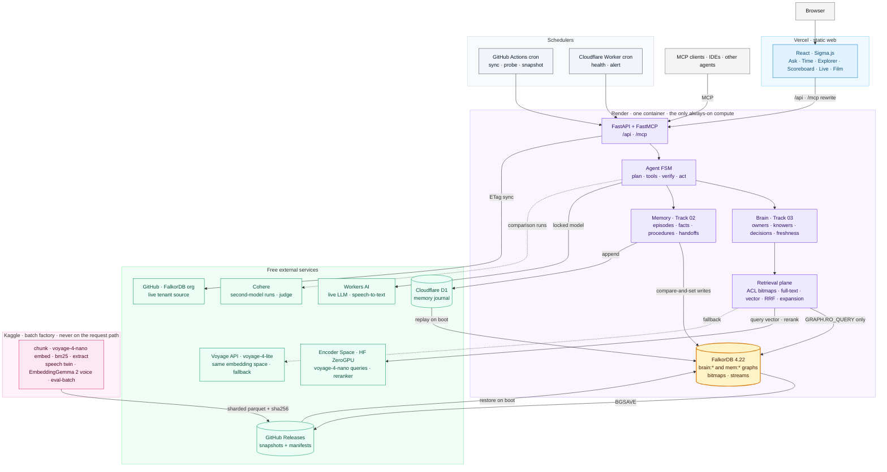
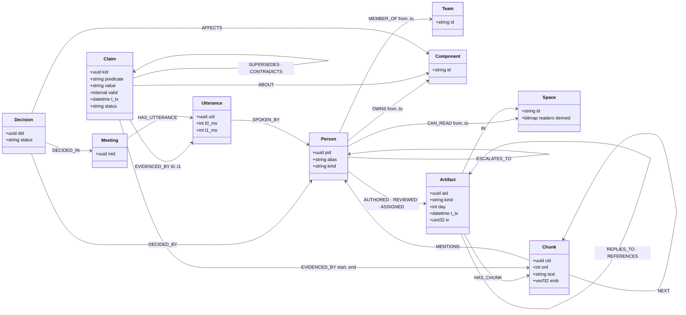
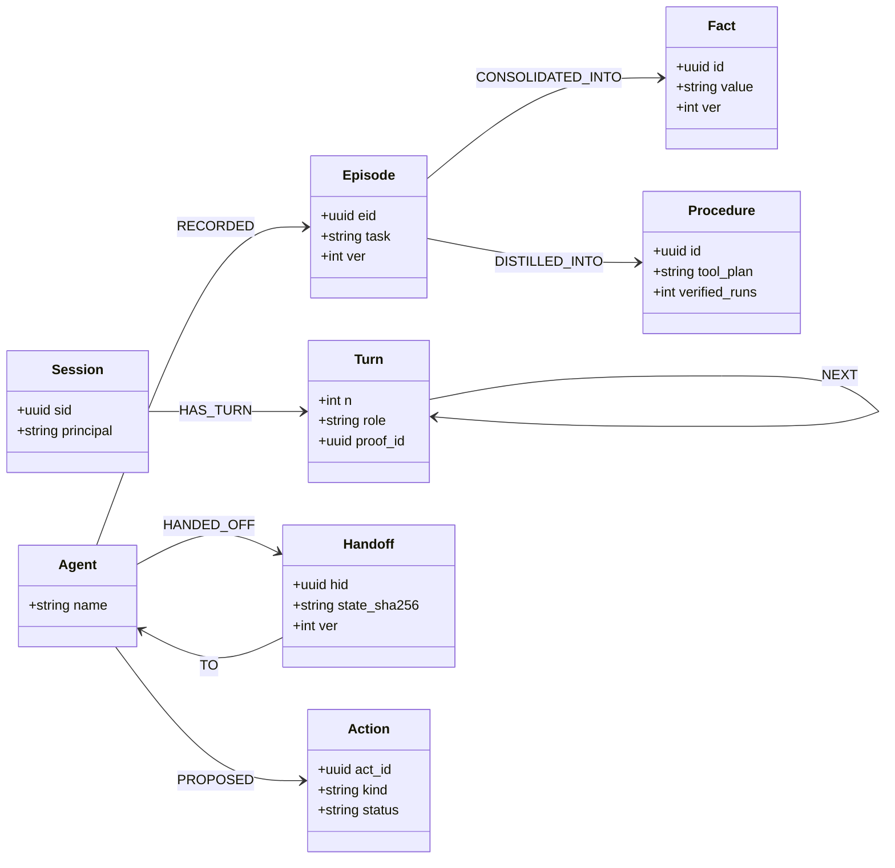
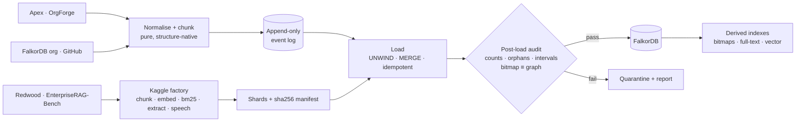
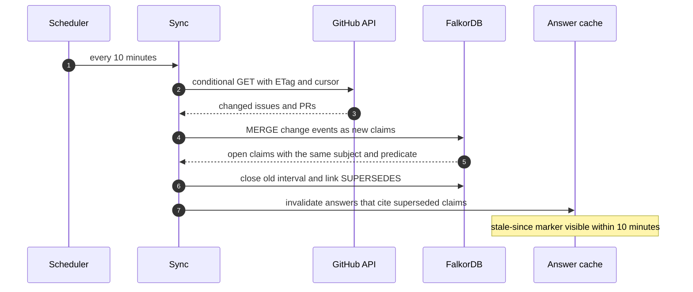
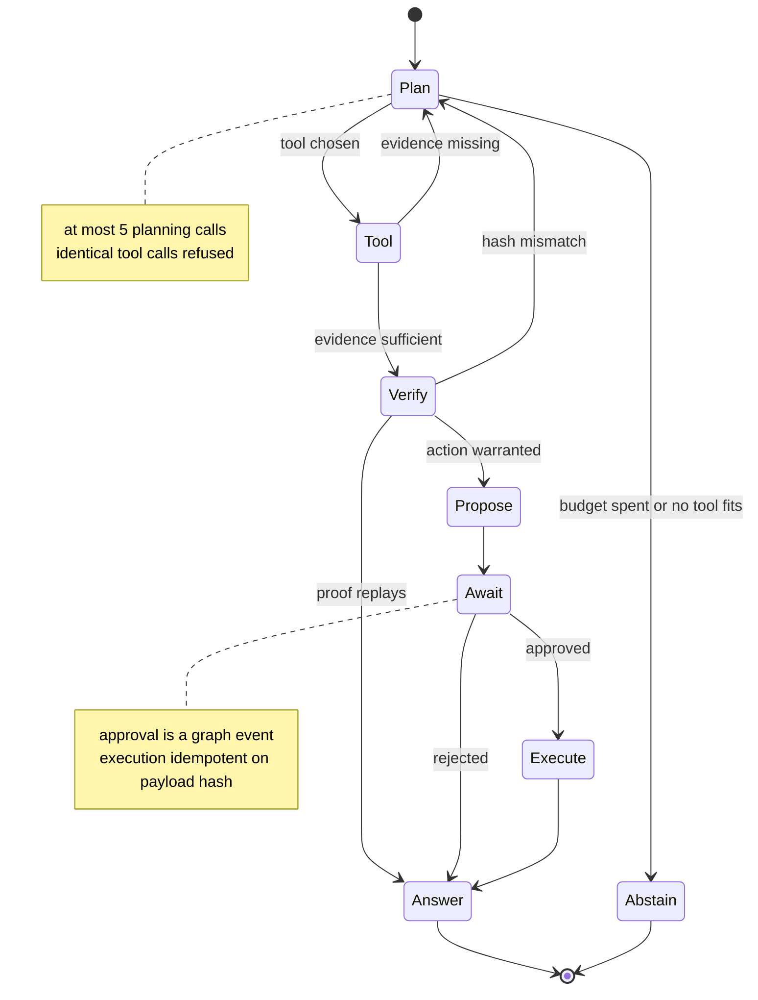
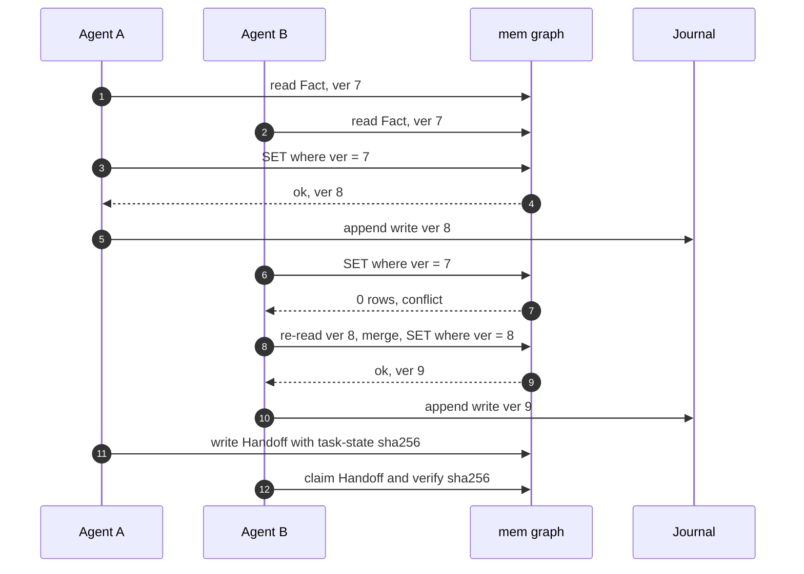
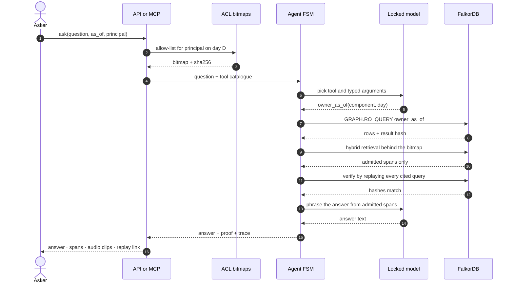

# CONSTELLATION — The Company Brain That Proves Every Answer

[SPEC:INDEX] — jump to any section: `grep -n '\[SPEC:' PLAN_SPEC.md`

| § | Anchor | What it settles |
|---|---|---|
| — | [SPEC:STANDARD] | The standard every line of this repository is held to |
| 0 | [SPEC:STATUS] | Status labels and the rule that a target is never a result |
| 1 | [SPEC:MISSION] | Thesis, track-to-capability map, why FalkorDB is load-bearing |
| 2 | [SPEC:CONSTITUTION] | Fourteen non-negotiable rules |
| 3 | [SPEC:SCOPE] | Built now, deferred, never |
| 4 | [SPEC:DATA] | Three tenants, derived sets, licences, pseudonyms, canary |
| 5 | [SPEC:ARCH] | Containers, bounded contexts, ports |
| 6 | [SPEC:GRAPH] | Nodes, edges, epistemic levels, bitemporal rules, indexes |
| 7 | [SPEC:CYPHER] | The Cypher and algorithms the product relies on |
| 8 | [SPEC:INGEST] | Event-sourced, idempotent, quote-verified ingestion |
| 9 | [SPEC:RETRIEVAL] | Permission-exact hybrid retrieval |
| 10 | [SPEC:BRAIN] | Track 03: who owns, who knows, what was decided, what changed |
| 11 | [SPEC:AGENTS] | Track 01: how agents reach Cypher, act and explain |
| 12 | [SPEC:MEMORY] | Track 02: memory layers, handoffs, concurrency, tenancy |
| 13 | [SPEC:AUDIO] | Speech twin and playable provenance |
| 14 | [SPEC:MODELS] | Model roles, model lock, token accounting |
| 15 | [SPEC:PROOF] | The proof and trace every answer carries |
| 16 | [SPEC:EVAL] | Gate sheet: ≥99% accuracy, 100% invariants, audit protocol |
| 17 | [SPEC:SECURITY] | Threats and controls |
| 18 | [SPEC:API] | HTTP and MCP contracts |
| 19 | [SPEC:WEB] | Public app and the demo film |
| 20 | [SPEC:DEPLOY] | Self-hosted FalkorDB, zero-cost topology, schedules |
| 21 | [SPEC:BATCH] | Kaggle batch jobs: embeddings, speech, indexes, benchmark runs |
| 22 | [SPEC:ENGINEERING] | Spec-driven TDD, commits, comments, quality chain, layout |
| 23 | [SPEC:WAVES] | Delivery waves and exit gates |
| 24 | [SPEC:DONE] | Definition of done |
| 25 | [SPEC:RISKS] | Risks and controls |
| 26 | [SPEC:DELIVERABLES] | Submission checklist mapped to the rules |
| 27 | [SPEC:DISCLOSURE] | Prior art and AI-assistance disclosure |
| 28 | [SPEC:REFERENCES] | Sources |
[/SPEC:INDEX]

> **What's true, who knew it, and when — exact to the bit, replayable to the source, on FalkorDB.**

Graph Hacks: Context for AI Agents (WeMakeDevs × FalkorDB) — entered in **Track 01, Track 02 and Track 03**. One graph model and one evidence contract power three products:

- **Company Brain (Track 03).** Ownership, knowledge, decisions and freshness across docs, tickets, chats, code and meetings.
- **Agents That Act (Track 01).** Multi-hop agents whose MCP tools are Cypher and graph algorithms; every action approval-gated and replayable.
- **Agent Memory and Coordination (Track 02).** Per-tenant and per-user memory graphs: episodic, semantic, procedural; shared state, handoffs, zero lost updates.

---

[SPEC:STANDARD]
## The Standard

Constellation is built to be the reference company brain on FalkorDB: the system others are measured against, not one more chatbot over documents.

- **Singular by construction.** The only company brain where every answer is a replayable proof of what was true, who knew it, and when — down to the permission bit, the character offset and the audio millisecond.
- **Judged by keys we did not write.** Two external benchmarks with public leaderboards, and a live tenant anyone can audit: FalkorDB's own open-source organisation.
- **99 or it is not done.** Every accuracy gate ≥99%. Every correctness invariant 100%. A miss becomes a root cause, a general fix and a regression test — never a patched question.
- **Every line earns its place.** No component without an ablation behind it, no number without a recorded run, no comment that restates the code.
- **Ship-grade from the first commit.** Public trunk, green on every commit, every decision written down with the alternative it beat.
[/SPEC:STANDARD]

---

[SPEC:STATUS]
## 0. Status labels and evidence rules

Every requirement carries one status:

- **Implemented**: verified in code and by a passing test or a recorded run.
- **Partial**: a primitive exists, but the behaviour users see is incomplete.
- **Missing**: no implementation evidence exists.

Rules:

1. **A target is never presented as a result.** A number appears in the README, on the site or in the video only after a recorded run produced it. Every recorded run includes the command, commit SHA, dataset revision, model IDs, and a per-question artifact.
2. Results are dated audit files in `docs/audits/`. This specification stays stable; current state lives in `STATE.md`.
3. Negative results are published next to positive ones.
4. Every acceptance criterion has an ID (`AC-<area>-<nn>`). CI fails if any AC lacks a test that references it (see [SPEC:ENGINEERING]).

Current status of every AC: **Missing**. The specification freezes before the first line of code.
[/SPEC:STATUS]

---

[SPEC:MISSION]
## 1. Mission and thesis

**Memory is visibility × time.**

A company's knowledge is not just a set of facts. Each fact was true during some interval, recorded at some moment, and visible to some people from some point on.

Constellation stores all three dimensions explicitly in FalkorDB:

- **Valid time.** When a fact held. This is the edge interval.
- **Transaction time.** When the company recorded it. This is the artifact timestamp.
- **Visibility.** Who could see it. These are space-membership edges, compiled into exact bitmaps.

Every answer is a **proof**: the read-only Cypher that ran, its parameters, the result hash, the cited spans (text offsets or audio milliseconds), and the permission check that admitted each span.

### 1.1 Track → capability map

| Track focus (from the official track text) | Constellation capability | Gate |
|---|---|---|
| **T3** Knowledge from docs, tickets and chats in one graph | Slack, email, Confluence, Jira, Zoom, PRs, Linear, Drive, HubSpot, Fireflies and GitHub ingested into one typed, bitemporal graph per tenant | AC-T3-01 |
| **T3** Who owns what, and who knows what | `OWNS` and `MEMBER_OF` intervals, plus a distinction between being **exposed** to a fact and **engaging** with it | AC-T3-02, AC-T3-03 |
| **T3** Tracing decisions back to their source | `Decision` nodes linked to the meeting utterance or message that made them, with playable audio spans | AC-T3-04, AC-AUD-02 |
| **T3** Keeping knowledge current | A live tenant (the FalkorDB open-source org) synced on a schedule. Claims are superseded or contradicted, and stale answers are invalidated | AC-T3-05 |
| **T3** Answers with clear sources | A proof object on every answer, which anyone can replay | AC-INV-03 |
| **T1** Multi-hop reasoning | A bounded agent finite-state machine over typed graph tools | AC-T1-01 |
| **T1** Graph queries and algorithms as tools | `.cypher` catalogue plus FalkorDB algorithms (BFS, shortest paths, PageRank, WCC, betweenness, CDLP) exposed as tools | AC-T1-02 |
| **T1** Tool selection through MCP | FastMCP server. The same tools serve the agent, external MCP clients and tests | AC-T1-03 |
| **T1** Actions based on what the graph shows | Routing, escalation and filing tickets. Actions are proposed from graph evidence and executed only after approval | AC-T1-04, AC-INV-05 |
| **T1** Explainable results | A trace that records every step, tool, token count, latency, strategy change and stop reason | AC-T1-05 |
| **T2** Episodic, semantic and procedural memory | `Episode`, `Fact` and `Procedure` layers with consolidation rules | AC-T2-01 |
| **T2** Persistent conversation history | `Session` and `Turn` subgraphs that survive restarts | AC-T2-02 |
| **T2** Shared state and handoffs between agents | `Handoff` nodes and a shared blackboard with versioned writes | AC-T2-03 |
| **T2** High-concurrency reads and writes | Compare-and-set writes with no lost updates, measured under 32 concurrent agents | AC-T2-04 |
| **T2** Separate memory per user or tenant | One graph per tenant and per user, cloned from a template with `GRAPH.COPY` | AC-T2-05 |

### 1.2 Why FalkorDB is load-bearing

If FalkorDB is removed, nothing works:

- Every answer is a Cypher read.
- Every agent tool is a Cypher query or a FalkorDB algorithm.
- Memory and tenancy are separate FalkorDB graphs.
- Permission bitmaps are Redis keys on the same server, derived from graph edges and checked against them.
- Vector and full-text search run on FalkorDB's own indexes.
- The live tenant is FalkorDB's own open-source organisation.

### 1.3 The five walls

| Wall | What it is | Why it is hard to match |
|---|---|---|
| **Truth** | Scored by answer keys we did not write: EpistemicBench and EnterpriseRAG-Bench, both with public leaderboards. Constructed suites are labelled as constructed | A self-made demo proves nothing; an external key does |
| **Bits** | Permissions compiled to exact bitmaps, checked before ranking and again before the prompt; bitmap ≡ graph proven by property tests | Zero leaks is an invariant, not a filter |
| **Proof** | Every answer replays: query, parameters, result hash, character and millisecond spans. Manifests on every artifact; the scoreboard reads from a ledger | Anyone can re-run any answer and get the same bytes |
| **Voice** | Meetings exist as speech: playable decision provenance, speech-to-graph fidelity, voice identity, spoken-only expertise | A text-only brain cannot cite the second a decision was spoken |
| **FalkorDB-native** | Algorithms as tools, `GRAPH.COPY` tenancy, a `GRAPH.RO_QUERY` read path, bitmaps and streams on the same server, MCP, both engine lines tested; the live tenant is FalkorDB's own organisation | Remove FalkorDB and nothing remains |
[/SPEC:MISSION]

---

[SPEC:CONSTITUTION]
## 2. Constitution (non-negotiable)

1. **Evidence or silence.** Every factual answer cites spans that were admitted by the asker's permissions. If there is no evidence, the answer is `not_found` and it says what was searched.
2. **Zero leaks.** A span the asker cannot read never reaches a prompt, a response, a log or a trace shown to that asker.
3. **Read path is read-only.** Query ports can only send `GRAPH.RO_QUERY`. Writes go through the ingestion and memory ports only.
4. **Actions need approval.** An agent can propose an action. Executing it requires an explicit approval, which is recorded as a graph event.
5. **Deterministic code owns truth.** Dates, intervals, counts, ownership and permission checks are computed by Cypher and code. LLMs plan, route, phrase and propose; they never compute these.
6. **Observed, derived and inferred stay distinct.** Every node and edge records `origin ∈ {observed, derived, inferred}` and the artifact it came from.
7. **Time is explicit.** No "current" fact exists without a valid-time interval and a transaction time. Anything time-dependent reads time through the `Clock` port.
8. **A repeated name does not prove a repeated person.** Identity merges are scored, reversible and logged.
9. **No answer hard-coding and no tuning on evaluation questions.** Nothing in the code or prompts keys on a question ID or on the text of a benchmark question. Generalisation is checked on paraphrased, unanswerable and held-out sets.
10. **Same model throughout a run.** Every LLM call in a benchmark run uses the one locked model. Deterministic steps report 0 LLM tokens.
11. **Reproducible or unclaimed.** Every published number has a command, a commit, data hashes and a per-question artifact.
12. **Complexity must pay for itself.** A component stays only if an ablation shows it improves a gate metric. Architecture for show is prohibited.
13. **Privacy by construction.** People in public corpora are shown as stable pseudonyms. Raw corpora are never re-published in bulk. Canary-marked benchmark content never reaches services that train on inputs.
14. **Source-of-truth order.** Tests and schemas define what the code must do. This file and its ADRs define the intended design. `STATE.md` records where things stand. Git records history. When any of these disagree, stop and reconcile before continuing.
[/SPEC:CONSTITUTION]

---

[SPEC:SCOPE]
## 3. Scope

### 3.1 In scope (hackathon build)

- **Three tenants:**
  - Apex Athletics (simulated company)
  - Redwood Inference (enterprise benchmark corpus)
  - FalkorDB OSS (live public org)
- **Graphs:**
  - A bitemporal company graph per tenant
  - A memory graph per user and session, cloned from a template
- **Retrieval:** permission-exact, combining a bitmap ACL filter, FalkorDB full-text and vector indexes, a BM25 sidecar for the 512k-document corpus, rank fusion, and graph expansion.
- **Agents and interfaces:**
  - A bounded agent finite-state machine
  - FastMCP tools generated from the `.cypher` catalogue
  - Approval-gated actions: a sandbox GitHub repository and a Discord webhook
- **Speech twin:** for Apex meetings, covering synthetic speech, speech recognition, utterance spans, voice identity and playable provenance.
- **Evaluation:**
  - EpistemicBench (OrgForge)
  - EnterpriseRAG-Bench
  - Constructed suites: ownership, escalation, freshness, leaks, concurrency, tenancy
  - Paraphrase, unanswerable and held-out sets
- **Public surfaces:**
  - A web app with a proof viewer, graph explorer, scoreboard and video chapters
  - Free hosting with scheduled jobs

### 3.2 Deferred (after the hackathon)

- A Rust/PyO3 bit-plane kernel. The numpy and Redis `BITOP` paths ship first.
- A CPU cross-encoder reranker on the hot path.
- Validation of FalkorDB engine 6.x beyond a smoke matrix. 4.22.x is primary.
- Arbitrary uploads from users, multi-organisation self-service sign-up, SSO.
- Learned routing policies (RL), fine-tuned models.
- Serving Redwood from the hosted API. Its 512k documents exceed free-tier memory; it ships as recorded runs and local replay ([SPEC:DEPLOY]).

### 3.3 Non-goals

- Cloning a real person's voice, or detecting emotion from speech.
- Unrestricted text-to-Cypher writes.
- Claiming results on data we generated ourselves as if they were independent benchmarks. Constructed suites are labelled as constructed.
- Re-hosting third-party corpora in bulk.
[/SPEC:SCOPE]

---

[SPEC:DATA]
## 4. Data

### 4.1 Tenants

| Tenant | Source | Licence | Size | Answer key we did not write |
|---|---|---|---|---|
| **Apex Athletics** | OrgForge simulated company (`aeriesec/orgforge` on Hugging Face) | MIT | 22,530 corpus rows. About 41 employees and 74 actors, plus customers and vendors. Simulated days −579…60. Slack, email, Confluence, Jira, Zoom transcripts, PRs, metrics, simulation events | EpistemicBench, 77 questions; the simulator's ground-truth snapshot |
| **Redwood Inference** | EnterpriseRAG-Bench (`onyx-dot-app/EnterpriseRAG-Bench`) | MIT | 511,962 documents, about 600.8M tokens, from Slack, Gmail, Linear, Drive, HubSpot, Fireflies, GitHub, Jira and Confluence | 500 questions with `expected_doc_ids`, `gold_answer` and `answer_facts` |
| **FalkorDB OSS (live)** | Public GitHub org `FalkorDB`: issues, PRs, reviews, releases, CODEOWNERS, docs | Public metadata; repository licences per repo | About 70 active repositories | Constructed by rules from GitHub's own state (assignees, reviewers, labels, timestamps) |

### 4.2 Rules for each tenant

- **Pinning:**
  - Apex and Redwood are pinned to a dataset revision hash.
  - The live tenant records an ETag and cursor for each sync.
  - Every ingest writes a manifest: source, revision, row count, and sha256 for every derived file.
- **Redwood canary.** The benchmark carries a canary GUID.
  - Redwood content is sent only to self-hosted models or to providers whose terms exclude training on inputs. Each provider is verified and recorded in an ADR before its first call.
  - Redwood text is never re-published in bulk. The web app shows only cited spans.
- **People:**
  - People in every tenant are shown as deterministic pseudonyms: a keyed HMAC turned into a word pair, stable within a tenant.
  - Bots are filtered from the live tenant.
  - The live tenant is reported at component level, not as an individual performance ranking.
- **Redwood has no ACLs or authors.** The person, project and time structure is extracted with quote verification: every extracted edge must point to an exact substring of its source.
  - A seeded ACL overlay is generated for **performance and leak testing only**. It is labelled synthetic and never used for an accuracy claim.

### 4.3 Derived sets (labels known by construction)

| Set | Built from | Purpose |
|---|---|---|
| Speech twin | 208 Apex Zoom transcripts → multi-voice synthetic speech | Speech-to-graph fidelity; playable provenance |
| Paraphrase set | Benchmark questions rewritten by a model different from the answering model; meaning checked by a third pass | Shows generalisation beyond the original wording |
| Unanswerable set | Questions about entities or intervals absent from the graph | Checks abstention; correct output is `not_found` |
| Leak traps | Questions whose only evidence the asker cannot read | AC-INV-01 |
| Contradiction set | Claims superseded or contradicted within the corpus timeline | Truth maintenance |
| Clone fleet | 1,000 memory graphs created with `GRAPH.COPY` | Tenancy isolation and latency |
| Held-out company | A second OrgForge simulation with a different seed, if compute allows | Shows generalisation beyond the one company |
[/SPEC:DATA]

---

[SPEC:ARCH]
## 5. Architecture

### 5.1 Containers (C4 level 2)



### 5.2 Bounded contexts (hexagonal)

| Context | Owns | Depends on |
|---|---|---|
| `domain` | IDs (UUIDv5), intervals, claims, ACL types, proof types. Pure code, no I/O | — |
| `graph` | FalkorDB adapter, `.cypher` catalogue, schema, migrations. `ReadPort` is restricted to `GRAPH.RO_QUERY` | `domain` |
| `ingest` | Source adapters, append-only event log, idempotent MERGE, manifests | `domain`, `graph` |
| `retrieval` | ACL bitmaps, lexical search, vector search, fusion, graph expansion | `domain`, `graph` |
| `brain` | Ownership, knowledge, decisions, freshness (Track 03) | `retrieval`, `graph` |
| `memory` | Sessions, episodic/semantic/procedural memory, tenancy, coordination (Track 02) | `graph` |
| `agents` | FSM, tool registry, actions, approvals (Track 01) | `brain`, `memory`, `retrieval` |
| `audio` | Synthetic speech, speech recognition, speaker identity, spans. Runs in a worker, never in the request path | `domain` |
| `eval` | Dataset loaders, metrics, judges, runners, run ledger | Everything above, through public interfaces only |
| `api` | HTTP and MCP adapters | `agents`, `brain`, `memory` |

- The dependency direction is enforced by `import-linter` contracts.
- `eval`'s independent answer checker reads benchmark files and simulator ground truth directly. It shares no parsing code with `ingest`.

### 5.3 Ports

- `ReadPort`: RO queries only.
- `WritePort`: ingestion and memory only.
- `Clock`
- `LLM`: locked per run.
- `Embedder`
- `ActionSink`: GitHub sandbox, Discord, dry-run.
- `BlobStore`: snapshots, indexes, audio.
- `Ledger`: runs and proofs.

Adapters exist for production and for tests (in-memory and testcontainers).
[/SPEC:ARCH]

---

[SPEC:GRAPH]
## 6. Graph data model

Each tenant has one graph, `brain:<tenant>`. Each user and session has one graph, `mem:<tenant>:<principal>`. `mem:template` is the template they are cloned from.

### 6.0 Model at a glance

Brain graph, `brain:<tenant>`:



Memory graph, `mem:<tenant>:<principal>`:



### 6.1 Nodes

| Label | Key properties |
|---|---|
| `Person` | `pid` (UUIDv5), `alias` (pseudonym), `kind ∈ {employee, customer, vendor, contributor}` |
| `Team`, `Component`, `Customer`, `Vendor`, `Space` | `id`, `name`. `Space` is a channel, mailbox, wiki space, project or repository: the unit permissions attach to |
| `Artifact` | `aid`, `kind`, `t_tx` (recorded at), `day`, `title`, `sha256`, `src_ref`, `ix` (a dense `uint32` used as the bitmap position) |
| `Chunk` | `cid`, `aid`, `ord`, `text`, `emb` (vecf32), `t0_ms`/`t1_ms` for speech |
| `Claim` | `kid`, `predicate`, `value`, `t_valid_from`, `t_valid_to`, `t_tx`, `origin`, `status ∈ {asserted, superseded, contradicted, retracted}` |
| `Decision` | `did`, `title`, `t_tx`, `status` |
| `Meeting`, `Utterance` | `mid`; `uid`, `t0_ms`, `t1_ms`, `speaker_conf`, `audio_ref` |
| `Session`, `Turn`, `Episode`, `Fact`, `Procedure`, `Agent`, `Handoff` | Memory graphs. Every writable node has a `ver` property |
| `Action` | `act_id`, `kind`, `payload_hash`, `status ∈ {proposed, approved, rejected, executed, failed}` |
| `Run`, `Proof` | Run ledger and answer proofs |

### 6.2 Relationships

| Relationship | Meaning |
|---|---|
| `(:Person)-[:MEMBER_OF {from,to}]->(:Team)` | Team membership |
| `(:Person)-[:OWNS {from,to,origin,aid}]->(:Component)` | Ownership interval |
| `(:Person)-[:ESCALATES_TO {from,to}]->(:Person)` | Escalation chain |
| `(:Person)-[:CAN_READ {from,to}]->(:Space)` | Permission. Bitmaps are compiled from this |
| `(:Artifact)-[:IN]->(:Space)` | Visibility container |
| `(:Person)-[:AUTHORED\|ASSIGNED\|REVIEWED\|ATTENDED]->(:Artifact\|:Meeting)` | Engagement |
| `(:Artifact)-[:HAS_CHUNK]->(:Chunk)`, `(:Chunk)-[:NEXT]->(:Chunk)` | Ordered evidence |
| `(:Artifact)-[:REPLIES_TO\|REFERENCES]->(:Artifact)` | Discourse links |
| `(:Artifact\|:Chunk)-[:MENTIONS]->(:Person\|:Component\|:Customer\|:Vendor)` | Quote-verified mentions |
| `(:Claim)-[:ABOUT]->(n)`, `(:Claim)-[:EVIDENCED_BY {start,end}]->(:Chunk\|:Utterance)` | Claim provenance down to character or millisecond offsets |
| `(:Claim)-[:SUPERSEDES\|CONTRADICTS]->(:Claim)` | Truth maintenance |
| `(:Decision)-[:DECIDED_IN]->(:Meeting\|:Artifact)`, `(:Decision)-[:DECIDED_BY]->(:Person)`, `(:Decision)-[:AFFECTS]->(:Component)` | Decision provenance |
| `(:Meeting)-[:HAS_UTTERANCE]->(:Utterance)-[:SPOKEN_BY {conf}]->(:Person)` | Speech provenance |
| `(:Session)-[:HAS_TURN]->(:Turn)-[:CITED]->(...)`, `(:Episode)-[:CONSOLIDATED_INTO]->(:Fact)`, `(:Agent)-[:HANDED_OFF]->(:Handoff)-[:TO]->(:Agent)` | Memory |

### 6.3 Epistemic distinction (who *knows* vs who *could know*)

- **Exposed by day D:** the person had `CAN_READ` on the `Space` of an evidencing artifact whose `day ≤ D`.
- **Engaged by day D:** the person `AUTHORED`, `REVIEWED`, `ASSIGNED` or `ATTENDED` (or replied to) an evidencing artifact whose `day ≤ D`.
- Answers about who knew something always report the level (engaged or exposed) and the first day for each person.

### 6.4 Bitemporal rules

- Intervals are half-open, `[from, to)`. `to = null` means still open.
- A new contradicting claim never deletes an old one. It closes the old interval and links the two with `SUPERSEDES` or `CONTRADICTS`.
- Reads "as of D" filter on both valid time and transaction time.

### 6.5 Indexes

- Range indexes on every key property, and on `Artifact.day` and `Artifact.t_tx`.
- A full-text index on `Chunk.text` (Apex and the live tenant) and on `Artifact.title`.
- A vector index on `Chunk.emb` (cosine). The dimension is fixed by ADR after the MRL ablation (default 256).
- The schema diagram is generated from the live graph by a script. CI fails if it differs from `docs/diagrams/schema.mmd`.
[/SPEC:GRAPH]

---

[SPEC:CYPHER]
## 7. Cypher and algorithm catalogue

- Every query lives in `src/constellation/graph/cypher/<name>.cypher`, with a typed parameter header.
- The catalogue generates MCP tools, HTTP endpoints and the `README` query table.
- Procedure signatures are pinned by snapshot tests against FalkorDB 4.22.x.

```cypher
// owner_as_of.cypher  — who owned a component on day D (half-open interval)
MATCH (p:Person)-[o:OWNS]->(c:Component {id: $component})
WHERE o.from <= $day AND (o.to IS NULL OR $day < o.to)
RETURN p.alias AS owner, o.from AS since, o.aid AS evidence
```

```cypher
// knowledge_frontier.cypher — who engaged with / was exposed to a claim by day D
MATCH (k:Claim {kid: $kid})-[:EVIDENCED_BY]->(:Chunk)<-[:HAS_CHUNK]-(a:Artifact)
WHERE a.day <= $day
OPTIONAL MATCH (e:Person)-[:AUTHORED|REVIEWED|ASSIGNED]->(a)
OPTIONAL MATCH (a)-[:IN]->(s:Space)<-[r:CAN_READ]-(x:Person)
WHERE r.from <= a.day AND (r.to IS NULL OR a.day < r.to)
RETURN collect(DISTINCT {who: e.alias, day: a.day}) AS engaged,
       collect(DISTINCT {who: x.alias, day: a.day}) AS exposed
```

```cypher
// decision_provenance.cypher — decision → where it was made → exact spans
MATCH (d:Decision {did: $did})-[:DECIDED_IN]->(src)
OPTIONAL MATCH (k:Claim)-[:ABOUT]->(d)
OPTIONAL MATCH (k)-[ev:EVIDENCED_BY]->(span)
RETURN d, src, collect({span: span, start: ev.start, end: ev.end}) AS spans
```

```cypher
// escalation_path.cypher — shortest escalation chain valid on day D
MATCH (a:Person {pid: $from}), (b:Person {pid: $to})
MATCH p = shortestPath((a)-[:ESCALATES_TO*..6]->(b))
WHERE all(r IN relationships(p) WHERE r.from <= $day AND (r.to IS NULL OR $day < r.to))
RETURN [n IN nodes(p) | n.alias] AS chain
```

```cypher
// stale_claims.cypher — claims about a component superseded since a reader last saw them
MATCH (new:Claim)-[:SUPERSEDES]->(old:Claim)-[:ABOUT]->(c:Component {id: $component})
WHERE new.t_tx > $since
RETURN old.kid, new.kid, new.t_tx
```

```cypher
// hybrid_vector.cypher — permission filtering happens before this via the bitmap allow-list
CALL db.idx.vector.queryNodes('Chunk', 'emb', $k, vecf32($q)) YIELD node, score
WHERE node.ix IN $allowed_ix
RETURN node.cid, node.aid, score
```

**Algorithms used as agent tools.** These are FalkorDB built-ins. Exact signatures are snapshot-tested.

| Algorithm | Used for |
|---|---|
| `algo.pageRank` | Expertise centrality per component |
| `algo.WCC` | Disconnected knowledge islands |
| `algo.betweenness` | Bus-factor bridges |
| CDLP | Detecting informal teams |
| `algo.BFS` and shortest paths | Impact radius and escalation chains |

**Memory compare-and-set write** (Track 02; write port only):

```cypher
MATCH (f:Fact {id: $id}) WHERE f.ver = $expected_ver
SET f.value = $value, f.ver = f.ver + 1, f.t_tx = $now
RETURN f.ver
```
[/SPEC:CYPHER]

---

[SPEC:INGEST]
## 8. Ingestion



1. **Fetch.** Every raw record is written to an append-only log, keyed by `sha256(source, native_id, content)`.
2. **Normalise.** Each source has a pure function that turns a raw record into typed domain events, covering artifacts, people, spaces, membership, ownership, mentions and claims.
   - **Chunking is structure-native and deterministic.** A chunk is what the source already delimits: one chat message with its thread pointer, one email, one ticket with its comments, one wiki section by heading, one meeting turn window, one PR description or review.
   - Long units split at headings, then paragraphs, under a token cap. Neighbours link by `NEXT` instead of duplicated overlap.
   - Every chunk carries a header (title, space, author alias, day), so it reads correctly on its own.
   - No model decides boundaries; the sources already did. Models are spent where they add signal: claim and decision extraction (step 6).
   - Apex and the live tenant chunk locally in seconds; Redwood chunks on Kaggle CPU ([SPEC:BATCH]).
3. **Identity.**
   - IDs are `UUIDv5(namespace(tenant), natural_key)`.
   - People are resolved on native IDs first, then on scored alias evidence.
   - Merges are logged and reversible (constitution rule 8).
4. **Load.**
   - Batched parameterised `UNWIND … MERGE`. Running it twice produces the same graph.
   - A post-load audit checks invariants: counts against the manifest, no orphan chunks, closed intervals well-formed, and every `CAN_READ` mirrored in the bitmaps.
5. **Derive.**
   - Bitmaps, the BM25 sidecar and vector values are derived indexes, each with a hash manifest.
   - Any derived index can be rebuilt from the graph and the log.
6. **Extract** (Redwood and free text).
   - Deterministic extractors run first: identifiers, ticket keys, PR numbers, emails, @-handles, dates.
   - Model extraction of claims and decisions runs only on the self-hosted batch model, on Kaggle.
   - An extracted edge is accepted only if its quote is an exact substring of its source span.
7. **Live sync** (FalkorDB OSS).
   - GitHub REST/GraphQL with ETags and an `updated_at` cursor.
   - Each sync is an ingest run with its own manifest.
   - A changed issue or PR emits claim events. Those can close earlier intervals (see truth maintenance in [SPEC:BRAIN]).
[/SPEC:INGEST]

---

[SPEC:RETRIEVAL]
## 9. Permission-exact hybrid retrieval

```text
query ─▶ principal bitmap (Redis BITOP over the principal's Spaces, as of D)
       ─▶ lexical  (FalkorDB full-text for Apex/live; BM25 sidecar for Redwood full text)
       ─▶ dense    (FalkorDB vector index over voyage-4-nano vectors; query vector from the encoder Space)
       ─▶ fusion   (reciprocal rank fusion, k=60; weights fixed by ablation, not tuned per question)
       ─▶ rerank   (open cross-encoder; kept only if its ablation wins; graph-resolved answers skip it)
       ─▶ graph expansion (NEXT neighbours, REPLIES_TO thread, Claim/Decision links) — every hop re-checked against the bitmap
       ─▶ evidence pack (ordered spans with offsets) ─▶ agent / answerer
```

- **Bitmaps.**
  - Each `Space` has one bitmap over `Artifact.ix`. A principal's allow-list is the OR of the bitmaps of the Spaces they can read on day D.
  - Each candidate is checked with a single bit test.
  - **Invariant:** the bitmap answer equals the result of the graph traversal (`CAN_READ`/`IN`) for every checked pair (AC-INV-02).
- **Filtering happens before ranking and again before the prompt.** Unreadable spans never enter a candidate list and never reach the model. The second check is defence in depth.
- **Redwood scale.**
  - 511,962 documents.
  - A full-text BM25 sidecar (bm25s), memory-mapped and hash-manifested.
  - The FalkorDB vector index over title plus the leading window of each document (dimension fixed by ADR).
  - Graph expansion over extracted entities.
- **Judge-free retrieval metrics.**
  - Recall@k and MRR against `expected_doc_ids`.
  - Gold-span hit rate for Apex, using simulator provenance.
[/SPEC:RETRIEVAL]

---

[SPEC:BRAIN]
## 10. Track 03 — Company Brain

| AC | Capability | Acceptance |
|---|---|---|
| AC-T3-01 | One graph across docs, tickets, chats, code and meetings | All source kinds for all three tenants are loaded; the manifest and post-load audit pass |
| AC-T3-02 | Who owned what, as of day D | Answers match the simulator's or GitHub's ownership state on ≥99% of a constructed probe set covering every component and every day an owner changed; 100% of answers carry a proof |
| AC-T3-03 | Who knew what, and when | Engaged and exposed people with the first day for each; 0 permission violations on EpistemicBench |
| AC-T3-04 | Decision provenance | Every `Decision` resolves to a source artifact or utterance with an exact span; for meeting decisions the span is playable |
| AC-T3-05 | Keeping knowledge current | A change in the live tenant becomes superseding claims; affected cached answers are invalidated and the "stale since" marker appears within 10 minutes of the sync (100% of probe changes) |
| AC-T3-06 | Coverage map | Documentation coverage for each component compared with the ownership registry, within 1 point of the constructed ground truth |
| AC-T3-07 | Expertise and bus factor | Ranked experts per component (PageRank over the engagement subgraph) and bridge people (betweenness); output is deterministic for a fixed graph hash |

**Truth maintenance.**

- A new claim with the same `(subject, predicate)` closes the open interval of the old claim and adds `SUPERSEDES`.
- An incompatible value inside an overlapping interval adds `CONTRADICTS`, and both claims are shown with their evidence.
- A sweep job re-checks open intervals against the latest synced state.


[/SPEC:BRAIN]

---

[SPEC:AGENTS]
## 11. Track 01 — Agents That Act

**FSM:** `PLAN → (TOOL)* → VERIFY → (ANSWER | PROPOSE_ACTION | ABSTAIN)`. Its limits:

- At most 5 planning calls.
- Identical repeated tool calls are refused (cached per run).
- `VERIFY` re-runs the cited Cypher and compares the result hashes.
- If the answer cannot be verified, the FSM abstains with the reason.



**How an agent reaches Cypher.** The model chooses *what to ask*; it almost never writes the query text.

| Tier | Who writes the Cypher | When it is used | Guarantee |
|---|---|---|---|
| 1. Catalogue | Engineers. Reviewed `.cypher` files, snapshot-tested | Default for every question a template covers | The model only picks a tool and fills typed arguments. Names resolve to IDs in a deterministic linker (full-text + alias index), never in the model. Replay is exact by construction |
| 2. Composition | Still the catalogue | Multi-hop questions | The FSM chains tools; each step passes IDs and days, never free text, to the next |
| 3. Guarded generation (`cypher_ro`) | The model, from a schema card read from the live graph and catalogue exemplars (never benchmark questions) | Long-tail questions no template covers, on principals with full visibility of the tenant | Five gates before a row is returned: `GRAPH.EXPLAIN` parses it without running it; a token and AST allowlist rejects `CREATE MERGE SET DELETE REMOVE DROP LOAD CSV` and unlisted procedures; a `LIMIT ≤ 200` is enforced; it runs as `GRAPH.RO_QUERY … TIMEOUT`, so the engine itself refuses writes; every returned artifact or chunk ID is re-checked against the bitmap |
| 4. Promotion | Engineers, from evidence | A generated query that verified on several distinct tasks | It is stored as a `Procedure` (procedural memory, Track 02) and proposed as a catalogue entry; it joins tier 1 only after review |

- Tier 3 is disabled for restricted principals: an aggregate over unreadable rows could leak a count, so the zero-leak invariant is kept by construction, not by filtering.
- The share of answers served by each tier is published with every run.

**Tools.**

- Tools are generated from the `.cypher` catalogue and the algorithm table. Graph tools are annotated `readOnlyHint`; action tools are annotated `destructiveHint` and require approval.
- The same FastMCP server serves the internal agent, external MCP clients and in-memory tests.

**Actions.**

- Actions are typed and proposed with graph evidence: route a ticket to an owner, escalate along `ESCALATES_TO`, file an issue in the sandbox repository, notify Discord.
- Approval writes `(:Action {status: 'approved'})` with the approver and time. Execution is idempotent on `payload_hash`.

| AC | Acceptance |
|---|---|
| AC-T1-01 | Multi-hop questions (≥2 hops) answered with a verified proof |
| AC-T1-02 | Every catalogue query and algorithm is callable as a tool; tool schemas are snapshot-tested |
| AC-T1-03 | MCP tool selection matches the expected tool family on ≥99% of the routing probe set |
| AC-T1-04 | Routing@1 and escalation-path exactness ≥99% against the ground truth |
| AC-T1-05 | 100% of answers carry the full trace ([SPEC:PROOF]) |
| AC-T1-06 | ≤1.3 LLM calls per question on average for factual questions; 0 agent writes outside the action and memory ports |
[/SPEC:AGENTS]

---

[SPEC:MEMORY]
## 12. Track 02 — Agent Memory and Coordination

**Layers.**

- **Episodic:** `Episode`, one per completed task, with its cited evidence.
- **Semantic:** `Fact`, consolidated from at least 2 agreeing episodes, or 1 episode plus graph verification.
- **Procedural:** `Procedure`, a successful tool sequence for a task type. It is reused only if it is re-verified on the current graph.

**Sessions and handoffs.**

- `Session` and `Turn` graphs persist across restarts. The API restores them by session ID.
- Prompts include only a bounded window plus a summary.
- Agents share a blackboard subgraph. A handoff writes a `Handoff` node that carries the task state, the evidence set and its version.

**Concurrency and tenancy.**

- Every write is a compare-and-set on `ver`. A conflict re-reads and retries with bounded backoff, and every retry is recorded.
- Each tenant and each user has its own graph, cloned from `mem:template` with `GRAPH.COPY`. No query can address another tenant's graph, because graph names are resolved from the authenticated principal.

**Durability on free compute.**

- Every memory write is appended to a journal (Cloudflare D1) before it is acknowledged.
- Snapshots run every 10 minutes and on shutdown.
- Boot restores the latest snapshot, then replays the journal past the snapshot's sequence number, so a restart loses nothing (AC-T2-02).



| AC | Acceptance |
|---|---|
| AC-T2-01 | Consolidation rules are property-tested. Procedures are reused only after re-verification |
| AC-T2-02 | Sessions survive a process restart and a snapshot restore |
| AC-T2-03 | A handoff preserves the task state with no loss, checked by a state-hash comparison |
| AC-T2-04 | 32 concurrent agents × 10,000 compare-and-set writes: 0 lost updates; final value equals the serial replay |
| AC-T2-05 | 1,000 cloned graphs: 0 cross-tenant reads in randomized probes; p99 clone time and query latency published |
| AC-T2-06 | Benchmark runs use isolated memory, so no question can see another question's memory |
[/SPEC:MEMORY]

---

[SPEC:AUDIO]
## 13. Speech twin and playable provenance

**Pipeline.**

1. Each Apex Zoom transcript is turned into speech with an open-weights synthetic voice (Kokoro-82M, Apache-2.0). Each pseudonymised speaker gets a stable synthetic voice; no real voice is cloned.
2. Speech recognition (faster-whisper large-v3-turbo).
3. Speaker attribution.
4. `Utterance` nodes with `t0_ms`/`t1_ms`.
5. Voice embeddings for speaker identity (EmbeddingGemma 2 audio tower). Retrieval over meetings uses the recognised text in the shared text space.

All of this runs as batch work, never in the request path.

**Playable provenance.** Any claim evidenced by an utterance links to an audio player that seeks to `t0_ms`.

**Fidelity measure.** Meeting-sourced questions are answered twice: from the original transcripts, and from the graph built from speech.

| AC | Acceptance |
|---|---|
| AC-AUD-01 | The score built from speech is ≥99% of the score built from text, on meeting-sourced questions |
| AC-AUD-02 | 100% of meeting-sourced claims carry a playable span; spans are checked by recognising the clip and matching the text |
| AC-AUD-03 | Speaker attribution accuracy is published against the transcript's speaker labels (where present) |
| AC-AUD-04 | Bytes per meeting-hour are published for PCM, Opus, transcript and binary embedding codes |
[/SPEC:AUDIO]

---

[SPEC:MODELS]
## 14. Models and LLM policy

| Role | Default | Constraint |
|---|---|---|
| Answering and planning | An open-weights instruct model on Cloudflare Workers AI, for the live app and benchmark runs; the same weights self-hosted on Kaggle when a run exceeds the free daily quota. Model ID pinned by ADR-0004 | The same model for every call in a run |
| Second model | Cohere Command (trial key, 1,000 calls a month) | A separate published run on Apex, never mixed with others |
| Judge (only where a benchmark requires one) | The benchmark's own judge prompt. Cohere judges open-model answers, so judge and answerer never share a family | Second-judge agreement reported on a 10% sample |
| Text embeddings | **voyage-4-nano** (Apache-2.0, 340M, 32k context, MRL 2048/1024/512/256, quantization-aware int8 and binary): documents on Kaggle, queries on the encoder Space. The Voyage 4 family shares one embedding space, so voyage-4-lite on the Voyage API is a drop-in query fallback | AC-MOD-01: runtimes with the same weights agree at cosine ≥ 0.999; the API fallback costs ≤ 1 point of Recall@10 on the Apex probe set |
| Embedding bake-off | EmbeddingGemma 2 (text tower) against voyage-4-nano on Apex gold spans and Redwood `expected_doc_ids`; judge-free Recall@10 and MRR | Winner recorded by ADR; the other stays as a published ablation |
| Voice | EmbeddingGemma 2 audio tower: speaker identity and voice codes | Batch only |
| Reranker | Open cross-encoder on the encoder Space (candidates: Qwen3-Reranker-0.6B, bge-reranker-v2-m3, both Apache-2.0); Voyage `rerank-2.5-lite` as fallback | Kept only if the Kaggle ablation raises Recall@10 or answer accuracy; tier-1 graph answers skip it |
| Bulk extraction | Self-hosted on batch compute | Redwood never leaves the self-hosted or no-training boundary |

**Model lock.**

- At run start the provider, model and decoding parameters are locked and hashed into the `Run` node.
- On a 429 response, retry the same model with backoff. Never switch model mid-run.

**Free-tier quotas** are budgeted before every run and logged after it: Workers AI daily neurons, Cohere trial calls (1,000 a month across endpoints), Voyage tokens (200M free; 3 requests a minute without a card), ZeroGPU minutes (5 a day on a free account), Kaggle GPU hours.

**Token accounting.**

- Only LLM tokens are counted. Graph, retrieval and deterministic steps report 0 tokens and their latency.
- Prompts are versioned files whose hashes are recorded in each run.
[/SPEC:MODELS]

---

[SPEC:PROOF]
## 15. Proof and trace schema



```json
{
  "answer": "…",
  "status": "answered | not_found | abstained",
  "as_of": {"valid_day": 42, "tx_time": "…"},
  "principal": "alias",
  "proof": {
    "queries": [{"name": "owner_as_of", "params": {"component": "…", "day": 42},
                 "engine": "falkordb 4.22.x", "result_sha256": "…"}],
    "spans": [{"aid": "…", "cid": "…", "start": 120, "end": 188}],
    "audio": [{"uid": "…", "t0_ms": 61230, "t1_ms": 64410}],
    "acl": {"bitmap_sha256": "…", "admitted": 7, "rejected": 3}
  },
  "trace": {
    "steps": 3, "tools": [{"tool": "owner_as_of", "llm_tokens": 0, "latency_ms": 4.1}],
    "llm_calls": [{"model": "…", "prompt_tokens": 812, "completion_tokens": 64, "latency_ms": 640}],
    "strategy_changes": [{"at": 2, "why": "empty result → widened interval"}],
    "stop_reason": "verified: result hash matched on replay"
  }
}
```

**Replay.** `POST /api/v1/proofs/{id}/replay` re-executes every query read-only against the pinned graph snapshot and reports whether every hash matches (AC-INV-03).
[/SPEC:PROOF]

---

[SPEC:EVAL]
## 16. Evaluation

### 16.1 Gate sheet

Correctness invariants must be **100%**. Accuracy gates are **≥99%**.

| ID | Metric | Gate |
|---|---|---|
| AC-INV-01 | Permission leaks across 1,000,000 randomized checks plus every leak trap | **0** |
| AC-INV-02 | Bitmap result ≡ graph traversal result | **100%** |
| AC-INV-03 | Proofs that replay with matching hashes | **100%** |
| AC-INV-04 | Meeting claims with a playable span | **100%** |
| AC-INV-05 | Executed actions with a recorded approval | **100%** |
| AC-INV-06 | Agent writes outside the action and memory ports | **0** |
| AC-EV-01 | EpistemicBench (OrgForge), permission-gated and violation-adjusted | **≥0.99**, 0 violations |
| AC-EV-02 | EnterpriseRAG-Bench correctness, official protocol | **≥99%** |
| AC-EV-03 | EnterpriseRAG-Bench Recall@10 on `expected_doc_ids` | **≥0.99** |
| AC-EV-04 | Ownership and escalation exactness (constructed from simulator and GitHub ground truth) | **≥99%** |
| AC-EV-05 | Routing@1 | **≥99%** |
| AC-EV-06 | Speech-built score as a share of the text-built score | **≥99%** |
| AC-EV-07 | Paraphrase, unanswerable and held-out sets, each scored separately | **≥99%** |
| AC-EV-08 | Live change reflected | **100% within 10 min** |

Performance figures are published as measured results, never as gates claimed in advance:

- Bitmap check time in ns.
- Filtered retrieval p50, p95 and p99 at 512k documents on a stated reference machine, and on the deployed host for the hosted tenants.
- Clone-fleet latency.
- Concurrency throughput.
- Resident memory per tenant.
- Tokens and LLM calls per question.

### 16.2 What 99% means on each benchmark

- **EpistemicBench has 77 questions**, so 76/77 is 98.7%. The gate therefore requires **77/77**. The benchmark also scores the retrieval path, so the trajectory has to be clean as well as the answer.
- **EnterpriseRAG-Bench has 500 questions**, so the gate allows at most 5 misses.

### 16.3 Gold-label audit

Both answer keys were generated synthetically.

- Any gold answer that contradicts its own source documents is logged in `docs/audits/gold-disputes.md`, with document IDs and quoted spans.
- We always publish the **official raw score** and the **audited score** side by side, never one without the other.
- Disputed items are reported upstream to the maintainers.

### 16.4 Protocol

1. A run is the CLI `constellation eval --suite <name> --model <id>`.
   - It writes per-question JSONL as each question completes and can resume after interruption.
   - It records the run in the ledger with the commit, dataset revision, prompt hashes and model lock.
2. Metrics are tiered:
   - **Tier 1, deterministic:** EM, token F1, fact recall against `answer_facts`, Recall@k, MRR, interval exactness.
   - **Tier 2:** the official judge, where the benchmark defines one.
3. **Every miss gets a trace and a root-cause class** (retrieval, linking, temporal, permission, synthesis, gold dispute).
   - Fixes target the general mechanism and come with a regression test. A fix never patches the individual question.
4. **Run-over-run diff.** Questions newly passing or failing, per category, per stage, plus token and latency deltas.
5. **Leakage control.**
   - Public questions never appear in prompts or few-shot examples.
   - Paraphrase, unanswerable and held-out sets run on every candidate release.
[/SPEC:EVAL]

---

[SPEC:SECURITY]
## 17. Security and data protection

| Threat | Control |
|---|---|
| Cypher injection | Only parameterised catalogue queries. LLM-written Cypher is disabled by default; when enabled for research it is parsed, allowlisted, RO-only, and bounded in time and rows |
| Prompt injection inside corpus text | Evidence is quoted as data inside delimited blocks. Tools are never chosen from text inside evidence. Actions need approval |
| Cross-tenant access | The graph name is derived from the authenticated principal; the client never supplies it |
| Permission bypass via expansion | Every expansion hop is re-checked against the bitmap; the bitmap-vs-graph invariant is tested |
| Secret leakage | Secrets live only in platform secret stores. Responses and logs pass through a credential-pattern redactor. `gitleaks` runs in CI |
| Supply chain | `uv.lock` and `pnpm-lock` committed. `osv-scanner` and `pip-audit` in CI. Container images pinned by digest |
| Abuse of the public demo | Per-IP rate limits, input length caps, read-only public role, actions reachable only by the sandbox principal |
| Benchmark contamination | Canary-marked content stays in the self-hosted or no-training boundary. Bulk corpus text is never published |
[/SPEC:SECURITY]

---

[SPEC:API]
## 18. Interfaces

**HTTP** (`/api/v1`):

| Endpoint | Purpose |
|---|---|
| `POST /ask` | `{tenant, question, as_of?, principal?}` → answer, proof and trace |
| `POST /proofs/{id}/replay` | Re-execute a proof |
| `GET /graph/neighbourhood` | Bounded subgraph for the explorer, filtered by the bitmap |
| `GET /scoreboard` | Latest recorded runs, from the ledger |
| `GET /memory/sessions/{id}` | Session history |
| `POST /memory/handoff` | Hand off a task to another agent |
| `POST /actions/{id}/approve`, `POST /actions/{id}/reject` | Approve or reject a proposed action |
| `GET /health`, `GET /ready` | `ready` checks the graph, indexes and snapshot hash |

**MCP** (`/mcp`, streamable HTTP):

- Tools are generated from the catalogue, plus `ask`, `replay_proof`, `propose_action` and memory tools.
- Graph tools are read-only; actions are destructive and approval-gated.
- Tool schemas are snapshot-tested. Contract tests use the in-memory client.
[/SPEC:API]

---

[SPEC:WEB]
## 19. Public surface

**Web app** at `constellation.philipsimonderock.com`, built with Vite, React, TypeScript, Sigma.js, TanStack Query and Tailwind.

| View | Shows |
|---|---|
| **Ask** | The answer with its proof: query, spans, audio clips and permission admits and rejects. A "view as" switch shows that the same question returns different, correct answers for different principals |
| **Time slider** | Ownership, membership and claims as of any day |
| **Explorer** | A neighbourhood graph that respects permissions |
| **Scoreboard** | Every recorded run, with raw and audited scores, misses and their root-cause classes |
| **Live** | The FalkorDB OSS tenant: last sync, superseded claims, stale-answer invalidations |
| **Film** | The demo video with chapter timestamps |

Accessibility: WCAG 2.2 AA contrast, keyboard navigation, reduced-motion support.

**Demo video.**

- Produced as code with Remotion: 3840×2160, motion graphics and screen captures of the live app.
- Subtitles: white body text with yellow emphasis.
- Licensed background music and premium typefaces.
- Chapter timestamps are shared by the video file and the web app's chapter list, from one `chapters.json`.
- Published to a Drive link for the submission, and embedded on the site.
[/SPEC:WEB]

---

[SPEC:DEPLOY]
## 20. Hosting topology and scheduled jobs

**FalkorDB is self-hosted, and every piece runs on a free tier with no card.**

| Component | Host | Notes |
|---|---|---|
| Web | Vercel Hobby | Static build on a global CDN. Custom domain by CNAME in the existing DNS zone. Rewrites `/api/*` and `/mcp` to the API, so the browser sees one origin. The site renders recorded results instantly, even while the API wakes |
| API, MCP and FalkorDB | Render free web service: one Docker image built on the pinned FalkorDB image, with the API beside it under a two-process supervisor | 512 MB. Hosts Apex, the FalkorDB OSS live tenant and the memory graphs; a CI check fails if snapshots outgrow the budget. The schedulers keep it warm (750 free instance-hours cover one service for a month) |
| Snapshots | GitHub Releases | Graph RDB snapshots and index shards with sha256 manifests, restored on boot (the free host has no persistent disk) |
| Encoder Space | Hugging Face ZeroGPU Gradio Space (free accounts may host two) | Stateless: voyage-4-nano query encoder and the reranker, nothing else. The W0 probe decides CPU or GPU execution and logs quota use. The Voyage API is its fallback |
| Memory journal | Cloudflare D1 | Append before acknowledge; replayed on boot ([SPEC:MEMORY]) |
| Redwood (512k documents) | Kaggle and a stated reference machine | Too large for 512 MB. Published as recorded runs with proofs; `docker compose up` rebuilds it from the public dataset and replays any proof locally |
| Batch compute | Kaggle ([SPEC:BATCH]) | Embeddings, speech, indexes, benchmark runs. Outputs are hash-manifested |
| Schedules | GitHub Actions cron (public repository) and a Cloudflare Worker cron | Monitoring never depends on the host it monitors |
| Engine matrix | FalkorDB 4.22.x primary; 6.0.x smoke tests in CI | Results for both published if the 6.x smoke tests pass |

**Staying awake on free tiers (checked October 2026):**

- **Render free:** 750 instance-hours per workspace per month, which covers one service for a 31-day month (744 h). It sleeps after 15 minutes without inbound requests and wakes in about a minute. It may restart at any time and has no persistent disk, hence snapshots and the journal. Exceeding the bandwidth allowance without a card suspends free services for the month, so the API serves JSON only; media and video come from CDNs.
- **Keep-warm:** a Cloudflare Worker cron pings every 5 minutes (primary, punctual); GitHub Actions pings every 10 minutes as a backup, because scheduled workflows can run late under load.
- **Vercel Hobby:** a static site never sleeps. Hobby cron runs at most once a day with ±59 minutes of precision, so it only triggers the nightly scoreboard.
- **Encoder Space:** pinged on the same schedule as the API.

**Rejected, with reason (ADR-0003, checked October 2026):**

- **FalkorDB Cloud free tier:** 100 MB, stopped after one idle day, deleted after seven, no backups. Paid tiers start at 1 GB.
- **Hugging Face Spaces as the API host:** Gradio and Docker Spaces now require a paid plan to create. Free accounts keep two ZeroGPU Gradio Spaces; one serves only the stateless encoder.
- **Koyeb, Fly.io, Railway, hyperscaler trials:** a card is required, or the free compute expires.
- **Coolify:** a strong self-hosting control plane, but it manages servers; it does not supply one. It remains an option for the reference machine.

**Scheduled jobs:**

| Interval | Job |
|---|---|
| Every 10 min | Live-tenant sync (ETag and cursor), then the truth-maintenance sweep |
| Every 5 min | Health check from the Worker, which alerts on failure |
| Hourly | "Apex live" clone advances one simulated day from the simulator's event stream |
| Nightly | BGSAVE snapshot uploaded with a manifest; judge-free scoreboard rerun |
| Every 15 min | End-to-end probe from GitHub Actions: ask, replay, check the hash |
[/SPEC:DEPLOY]

---

[SPEC:BATCH]
## 21. Batch compute on Kaggle

Kaggle is the factory; the VM is the shop. Anything heavy, embarrassingly parallel or GPU-bound runs as a Kaggle job. Nothing on the request path depends on Kaggle.

**Mechanics.**

1. Each job is a script in `jobs/<name>/` with a `kernel-metadata.json`: a private kernel, the accelerator, internet on, and pinned inputs.
2. `kaggle kernels push` launches it. `kaggle kernels status` polls it. `kaggle kernels output` collects it.
3. Inputs are pulled inside the job at a pinned dataset revision, or attached as a private Kaggle dataset.
4. Output is sharded Parquet plus `manifest.json` (sha256 per shard, row counts, model ID, code SHA).
5. Jobs checkpoint per shard. A rerun skips every shard whose hash already verifies, so a session limit costs minutes, not the job.
6. The loader refuses any shard whose hash does not match the manifest.

| Job | Accelerator | Produces |
|---|---|---|
| `embed-apex` | GPU | voyage-4-nano and EmbeddingGemma 2 chunk embeddings for Apex and the live tenant: the bake-off, plus the MRL and precision ablation (2048 → 256, float → binary) |
| `embed-redwood` | GPU | voyage-4-nano embeddings over the title and leading window of all 511,962 documents |
| `bm25-redwood` | CPU (high RAM) | The memory-mappable BM25 sidecar over full Redwood text |
| `extract-redwood` | CPU, then GPU | Deterministic extraction everywhere; model extraction only on ambiguous spans; quote check on every edge |
| `speech-twin` | GPU | Synthetic speech for 208 meetings → recognition → utterance spans → audio embeddings → Opus clips |
| `rerank-ablation` | GPU | Recall@10 and answer accuracy with and without each candidate reranker |
| `eval-batch` | GPU | The pinned open-weights model served locally; benchmark suites as per-question JSONL with the model lock |
| `heldout-company` | GPU | Optional second simulated company for the held-out set |

**Rules.**

- Redwood jobs and outputs stay private (canary rule, [SPEC:DATA]).
- GPU hours are budgeted per job before launch and logged after.
- A batch result enters the scoreboard only through the same ledger and manifest checks as a local run.
[/SPEC:BATCH]

---

[SPEC:ENGINEERING]
## 22. Engineering system

### 22.1 Spec-driven, test-first

1. Every AC in this file has an ID.
2. Tests declare `@pytest.mark.ac("AC-…")`. `scripts/check_traceability.py` fails CI if any AC has no test, or if a test names an unknown AC.
3. Each AC follows the same cycle:
   - **Red:** a failing test commit with `xfail(strict=True)`.
   - **Green:** the implementation commit, which removes the `xfail`.
   - **Refactor:** an optional third commit.
4. Every commit is green.
5. Test kinds:
   - Unit tests.
   - Property tests (Hypothesis): interval algebra, bitmap ≡ graph, compare-and-set serializability, MERGE idempotence.
   - Snapshot tests: tool schemas, Cypher catalogue, schema diagram.
   - Integration tests: FalkorDB in testcontainers, pinned by digest.
   - Contract tests: the in-memory MCP client.
   - Evaluation tests: small fixed slices in CI; full runs on batch compute.

### 22.2 Block protocol (how every change is built)

Every change is a **block**: one concern, one AC, about 200 changed lines at most. No block starts until the previous one is green in CI.

1. **Ready.** The AC is written; the contract (types, Cypher, schema) is sketched inside the test; inputs and expected outputs are pinned.
2. **Red.** The failing test is committed with `xfail(strict=True)`, proving it can fail.
3. **Green.** The smallest implementation that passes. No speculative options, no unused parameters.
4. **Prove.** The full local chain. Accuracy and performance blocks also record a before-and-after measurement in the ledger.
5. **Review.** Read the diff as a reviewer: names, invariants stated in comments, error paths, no dead code, no secrets. Ask what breaks it at ten times the data.
6. **Ship.** Commit, push, watch CI.

- Spikes live in `spikes/` and are deleted, never merged. What a spike teaches comes back as a block with tests.
- A block touches one bounded context unless its AC spans two.
- Code produced with tool or assistant help is held to the same protocol and read line by line before it is committed.

### 22.3 Commit protocol

- **Trunk-based on `main`.** One logical change per commit, pushed right after the local gate passes.
- **Conventional Commits:** `<type>(<context>): <summary>`.
  - Types: `feat fix test refactor perf docs build ci chore`.
  - Context is a bounded-context name or `spec`, `web`, `infra`, `eval`.
  - Body: at most three lines on what changed and why.
  - Footer: `Refs: AC-…` where applicable.
- **Decisions** become ADRs in `docs/adr/NNNN-title.md`: context, decision, rejected alternatives, validation, revisit trigger.

### 22.4 Local and CI quality chain

```bash
uv run ruff check && uv run ruff format --check \
 && uv run mypy --strict src tests \
 && uv run pytest -q \
 && uv run lint-imports && uv run deptry src \
 && uv run vulture src --min-confidence 80 && uv run bandit -q -r src \
 && uv run python scripts/check_traceability.py
pnpm -C web lint && pnpm -C web typecheck && pnpm -C web test
```

CI (GitHub Actions) runs the same chain, plus `gitleaks`, `osv-scanner`, integration tests against FalkorDB 4.22.x and a 6.0.x smoke test, and a check that the schema diagram has not drifted.

**Code style:**

- Python 3.13 via `uv`. Strict typing. No wrapper abstraction without a second caller.
- **No docstrings, no banner blocks.** Notes are inline comments in the language's own symbol: `#` in Python, YAML and shell; `//` in TypeScript and Cypher.
- **Comments carry what the code cannot say.** A comment states a contract, an invariant, a unit or the reason behind a non-obvious choice. It never narrates the next line.

```python
# half-open [from, to): on a handover day the new owner answers
# RO_QUERY on purpose: the engine refuses writes even if a template regresses
# bit i ⇔ Artifact.ix == i; rebuilt from CAN_READ, never edited in place
```

### 22.5 Repository layout

```text
constellation/
├── PLAN_SPEC.md            # this file — intended design and acceptance criteria
├── STATE.md                # current state, latest measured results, ordered next actions
├── README.md               # overview, setup, graph model, Cypher, results, disclosure
├── src/constellation/
│   ├── domain/  graph/ (cypher/*.cypher)  ingest/  retrieval/
│   ├── brain/  memory/  agents/  audio/  eval/  api/
├── tests/  unit/ property/ integration/ contract/ eval/
├── web/                    # Vite + React + TS
├── video/                  # Remotion composition, chapters.json
├── infra/                  # space/, vercel.json, worker/, compose.yaml
├── jobs/                   # batch jobs (embeddings, speech, extraction, eval)
├── docs/  adr/ audits/ diagrams/
└── scripts/
```
[/SPEC:ENGINEERING]

---

[SPEC:WAVES]
## 23. Delivery waves

Each wave ends with something deployable. No wave starts until the previous wave's exit gate passes.

| Wave | Content | Exit gate |
|---|---|---|
| **W0 Foundation** | Repository, CI chain, traceability check, FalkorDB in testcontainers, `domain` types, hosting probe (ADR-0003), model probes (ADR-0004), dataset pins and manifests | CI green; a FalkorDB snapshot boots on the chosen host; manifests committed |
| **W1 Apex brain** | Apex ingestion → graph; ownership, membership and escalation intervals; claims; Cypher catalogue v1; proof and replay | AC-T3-01/02, AC-INV-03 green on Apex; first EpistemicBench run recorded |
| **W2 Exact retrieval + agent** | Bitmaps, full-text, vector, fusion, expansion; agent FSM; MCP tools; trace | AC-INV-01/02, AC-T1-01/02/03/05 green; leak suite at 0 |
| **W3 Scale + live** | Redwood ingestion, BM25 sidecar, vectors (batch); EnterpriseRAG-Bench run; live FalkorDB OSS tenant with sync and truth maintenance | AC-EV-02/03 recorded; AC-T3-05 green; schedules running |
| **W4 Memory + actions + speech** | Memory layers, sessions, handoffs, compare-and-set, `GRAPH.COPY` fleet; approval-gated actions; speech twin | AC-T2-01…06, AC-T1-04/06, AC-INV-04/05/06, AC-AUD-01…04 |
| **W5 Surface** | Web app, deployment, scoreboard from the ledger, README with graph model and Cypher, blog post | Live URL passes the end-to-end probe |
| **W6 Proof of record** | Full benchmark runs, gold audit, generalisation sets, demo video, submission | Every published number traces to a ledger run; submission checklist complete |

Waves W1–W4 iterate the miss → root cause → general fix → regression test loop until each gate is met.
[/SPEC:WAVES]

---

[SPEC:DONE]
## 24. Definition of done

- Every AC has a passing test or a recorded run; `STATE.md` shows its status.
- The gate sheet ([SPEC:EVAL]) is published with raw and audited scores, misses and root causes.
- The live deployment passes the end-to-end probe; snapshots restore after a cold start.
- The README contains setup, the graph data model, the Cypher catalogue, results, limitations and the AI-assistance disclosure.
- The demo video and blog post are published; every claim in them traces to a ledger run.
- No secrets, bulk corpus text or unpseudonymised people in the repository or the app.
[/SPEC:DONE]

---

[SPEC:RISKS]
## 25. Risks and controls

| Risk | Control |
|---|---|
| Synthetic gold-label noise caps measurable accuracy | Gold-dispute audit with quoted evidence; always publish raw and audited scores |
| Overfitting to public questions | No question text in prompts; paraphrase, unanswerable and held-out sets; run-over-run diffs |
| Host limits or trial-credit expiry | Snapshots in object storage restore on any host in minutes; zero-card fallback host defined in ADR-0003 |
| Redwood scale versus free memory | BM25 sidecar memory-mapped; vectors over leading windows at MRL dimension; hot-memory figure published |
| Engine version drift (4.22 vs 6.x) | Pinned image digests; procedure-signature snapshots; 6.x smoke matrix |
| Model drift or rate limits | Model lock per run; retry on the same model; batch runs on self-hosted weights |
| Identity over-merge | Scored, reversible merges; native IDs first |
| Speech pipeline cost | Batch-only; derived artifacts cached with hashes |
| Architecture for show | Constitution rule 12: a component stays only if an ablation shows it helps |
| Free-tier quotas (Workers AI neurons, Cohere trial calls, Render bandwidth) | Quota budget per run; answer cache; batch runs on self-hosted weights; video and media served from CDNs, never from the API host |
[/SPEC:RISKS]

---

[SPEC:DELIVERABLES]
## 26. Submission checklist (mapped to the official rules)

- [ ] Public source repository — `github.com/simon-derock/constellation`
- [ ] README with setup instructions and the graph data model
- [ ] The Cypher queries and graph algorithms the product relies on ([SPEC:CYPHER], generated table in README)
- [ ] Demo video of the working project (Drive link plus the site's Film view)
- [ ] Live deployment — `constellation.philipsimonderock.com`, plus full local setup (`docker compose up`)
- [ ] Tracks named: **Track 01, Track 02, Track 03**
- [ ] AI-assistance disclosure in the README
- [ ] Blog post (side prize)
[/SPEC:DELIVERABLES]

---

[SPEC:DISCLOSURE]
## 27. Prior art and disclosure

- **Prior art.** The author previously built *Stellium* (an agentic GraphRAG system on TigerGraph) and *Lunarbit* (an evidence-verifiable commerce GraphRAG system on Neo4j). Constellation reuses their engineering practices: status labels, measurement discipline, a constitution and a run ledger. It reuses none of their code. All of Constellation's FalkorDB work is new work done during the event.
- **AI assistance.** AI coding assistants are used during development, as the rules allow, and are disclosed in the README. The author reviews and verifies every change and can explain the code, the graph model, the queries and the architecture decisions.
- **Data.** Only public or synthetic data is used, under the licences in [SPEC:DATA].
[/SPEC:DISCLOSURE]

---

[SPEC:REFERENCES]
## 28. References

- Hackathon: https://www.wemakedevs.org/hackathons/falkordb · rules: https://www.wemakedevs.org/hackathons/falkordb/rules
- FalkorDB docs (Cypher, indexes, algorithms, `GRAPH.RO_QUERY`, `GRAPH.COPY`): https://docs.falkordb.com
- OrgForge / EpistemicBench: https://github.com/aeriesec/orgforge · https://huggingface.co/datasets/aeriesec/orgforge
- EnterpriseRAG-Bench: https://huggingface.co/datasets/onyx-dot-app/EnterpriseRAG-Bench
- FastMCP: https://gofastmcp.com
- EmbeddingGemma 2: https://huggingface.co/google/embeddinggemma-2
- Kokoro-82M: https://huggingface.co/hexgrad/Kokoro-82M · faster-whisper: https://github.com/SYSTRAN/faster-whisper
- Remotion: https://www.remotion.dev
[/SPEC:REFERENCES]
