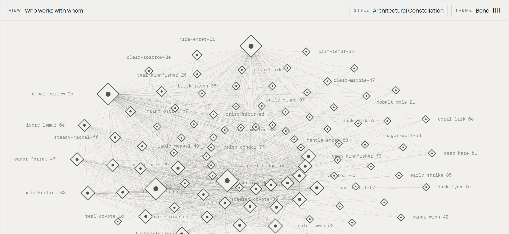
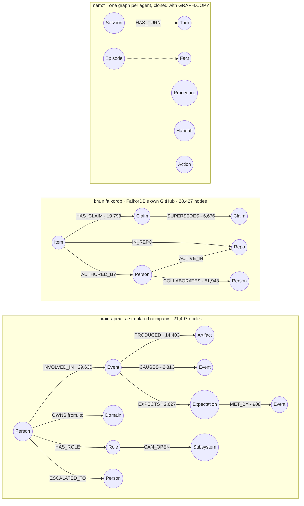
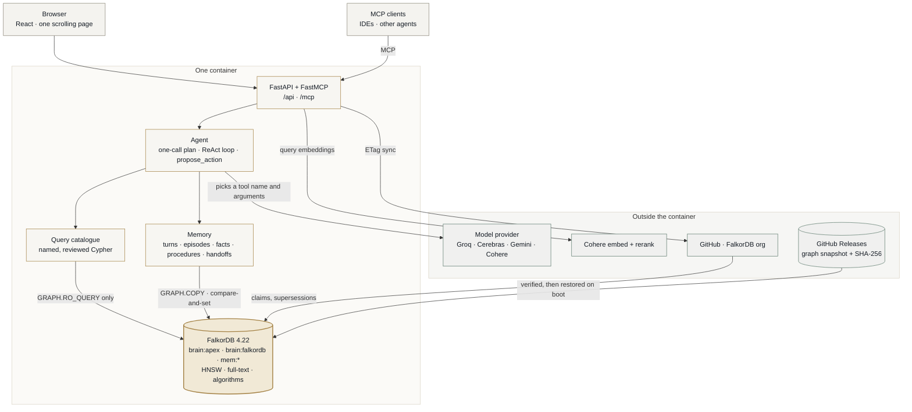
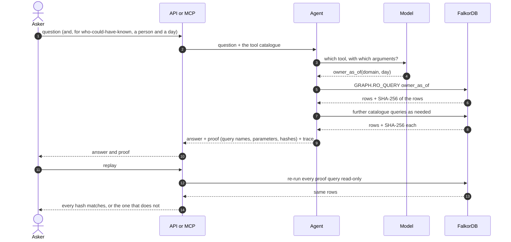
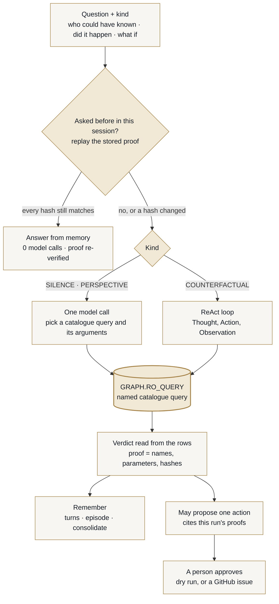
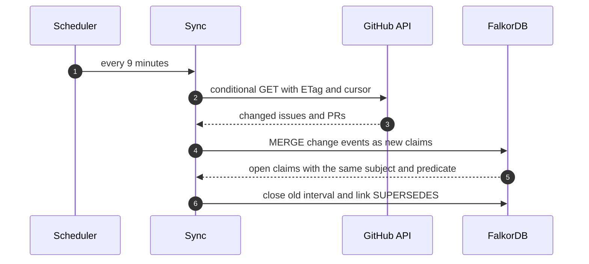

# Constellation

**A company brain on FalkorDB where every answer carries the queries that produced it, and anyone can replay them.**

Built for **Graph Hacks: Context for AI Agents** (WeMakeDevs × FalkorDB), and entered in all three tracks: **03 · Company Brain**, **01 · Agents That Act** and **02 · Agent Memory and Coordination**. One FalkorDB graph engine does the work for all three.

> **Status:** a working build, tested end to end. Everything on this page is implemented unless it is listed under [What is not built](#what-is-not-built). Every number comes from a recorded run in [`results/published`](results/published). Setup is under [Running it](#running-it).



## Why it is different

Most company-knowledge agents retrieve text and hope. Constellation computes the answer inside FalkorDB and hands back the evidence:

- **Proof.** An answer is a list of named, reviewed Cypher queries with their parameters and a SHA-256 of each result. *Replay* re-runs them read-only through `GRAPH.RO_QUERY`, and any change shows up on the exact query that changed.
- **Time.** Facts are claims with a valid-from and a valid-to, linked by `SUPERSEDES`. "Who owned it on day D" is a query, and nothing is ever overwritten.
- **Visibility.** A "who could have known" question is answered from one person's point of view: what they could see by that day is part of the query. On the benchmark's 30 such questions, none of 62 lookups reached past it.
- **The agent picks names, not Cypher.** The model chooses a catalogue query and its arguments; the verdict is read from the graph's rows.
- **One engine.** HNSW vector search, full-text search, PageRank, betweenness, shortest paths, per-agent memory graphs (`GRAPH.COPY`) and read-only enforcement (`GRAPH.RO_QUERY`) all run in one FalkorDB: about 50,000 nodes in 74 MB.

## Tracks

| Track | What Constellation does |
|---|---|
| **03 · Company Brain** | A simulated company (Apex) and FalkorDB's own public GitHub organisation in one engine. Who owned what on any day, who could have known an event, whether an expected follow-up ever happened, what caused what, what was open eight weeks ago, who is most connected and who bridges the others. Every answer replays |
| **01 · Agents That Act** | The agent calls reviewed catalogue queries and FalkorDB algorithms as tools, also served over MCP. After an answer it may propose one follow-up action that cites proofs from that run, and a person approves it: a dry run by default, a GitHub issue when an operator approves with a token |
| **02 · Memory and Coordination** | One graph per agent, cloned with `GRAPH.COPY`: session turns, episodes, consolidation into learned facts, and procedures that are replayed against the current graph before they are reused. Compare-and-set facts with no lost updates, and hand-offs where exactly one claimant wins. Ask records into it, and `/mcp` exposes it to other agents |

## The graph, and where every decision comes from it

FalkorDB is not storage behind Constellation; it is where each answer is computed. One engine (FalkorDB 4.22, about 50,000 nodes in 74 MB) holds three families of graph, and the agent only ever reaches them through named, reviewed queries.



How a question reaches the graph, and which FalkorDB feature answers it:

| The agent's decision | Tool the model calls | FalkorDB does the work with |
|---|---|---|
| Who owned this on day D? | `owner_as_of` | `MATCH (p)-[o:OWNS]->(d) WHERE o.from <= $day AND (o.to IS NULL OR $day < o.to)`: time is an interval on the edge |
| Who could have known about this event? | `could_have_known` | `apex_cone` (the person's visibility on that day) intersected with `shared_involvement`: permissions are part of the query |
| Did the expected follow-up ever happen? | `absence` | `(:Event)-[:EXPECTS]->(x)` then `OPTIONAL MATCH (x)-[:MET_BY]->(r)`: the graph records what was expected, so silence is a result, not a guess |
| Would it still have happened without this cause? | `counterfactual` | `(c)-[:CAUSES {link_type}]->(effect)`: the alternative causes of one effect |
| Who is most connected, and who bridges the others? | `live_central_people`, `live_bridge_people` | `algo.pageRank` and `algo.betweenness` over `COLLABORATES`, run inside the engine |
| How are two people connected? | `live_path` | `shortestPath((a)-[:COLLABORATES*..8]->(b))` |
| Which issues match this phrase? | `live_search_vector` + `live_search_text` | `db.idx.vector.queryNodes` (HNSW, cosine) and `db.idx.fulltext.queryNodes`, fused by reciprocal rank |
| What was open eight weeks ago? | `live_state_as_of` | `Claim` nodes with valid-from and valid-to, linked by `SUPERSEDES`: history is queried, never reconstructed |
| What does the agent remember? | memory tools | per-agent graph from `GRAPH.COPY`; writes are compare-and-set |

Every row above is a named `.cypher` file in [`src/constellation/graph/cypher/`](src/constellation/graph/cypher). The model picks the name and the arguments; it does not write query text. Each call returns its rows and a SHA-256 of them, and replaying a proof re-runs the same queries through `GRAPH.RO_QUERY`.

## Architecture



## How an answer is proven



## Graph data model

The properties below are read from the running graphs, not from the design.

**`brain:apex`** (21,497 nodes): a simulated company with its own answer key.

| Node | Properties |
|---|---|
| `Person` | `name`, `id`, `kind` |
| `Event` | `eid`, `id`, `day`, `type`, `summary`, `broadcast`, `spawned_doc` |
| `Artifact` | `doc_id`, `id`, `kind`, `title`, `body`, `born`, `row_day` |
| `Expectation` | `key`, `response_type`, `responded`, `search_space` |
| `Domain`, `Role`, `Subsystem` | `name` |

| Relationship | Meaning |
|---|---|
| `(Person)-[:OWNS {from, to, origin, evidence, start_known}]->(Domain)` | ownership as an interval |
| `(Person)-[:INVOLVED_IN]->(Event)`, `(Event)-[:PRODUCED]->(Artifact)` | who took part in what, and what it left behind |
| `(Event)-[:CAUSES {link_type, day}]->(Event)` | the causal chain |
| `(Event)-[:EXPECTS]->(Expectation)-[:MET_BY]->(Event)` | what should follow an event, and whether it did |
| `(Person)-[:HAS_ROLE]->(Role)-[:CAN_OPEN]->(Subsystem)` | what a person can see |
| `(Person)-[:ESCALATED_TO {eid, ord, day}]->(Person)` | escalation paths |

**`brain:falkordb`** (28,427 nodes): FalkorDB's public GitHub organisation. People are HMAC pseudonyms, and no issue body is stored.

| Node | Properties | Index |
|---|---|---|
| `Item` | `id`, `repo`, `number`, `kind`, `title`, `created`, `updated`, `embedding` | HNSW vector on `embedding`, full-text on `title`, range on `id` and `repo` |
| `Claim` | `id`, `predicate`, `value`, `valid_from`, `valid_to`, `origin` | range on `id` |
| `Person`, `Repo`, `Cursor` | `alias` · `name` · `repo` | range |

Relationships: `(Item)-[:HAS_CLAIM]->(Claim)`, `(Claim)-[:SUPERSEDES]->(Claim)`, `(Item)-[:IN_REPO]->(Repo)`, `(Item)-[:AUTHORED_BY]->(Person)`, `(Person)-[:ACTIVE_IN]->(Repo)`, and `(Person)-[:COLLABORATES {repos}]->(Person)`, a projection the PageRank, betweenness and shortest-path queries run on.

**`mem:<tenant>:<principal>`**: one graph per agent or user, cloned from `mem:template` with `GRAPH.COPY`. Nodes: `Fact` (versioned, compare-and-set), `Session` and `Turn`, `Episode`, `Procedure`, `Handoff`, and the action ledger's `Action`.

## The agent



The model chooses *what to ask*, never query text: every tool is a reviewed `.cypher` file, run with `GRAPH.RO_QUERY`. For *did it happen* and *who could have known*, one model call picks the tools and the server reads the verdict from the rows. *What if* questions run a short ReAct loop over the causal links, with repeated identical calls refused. A proposed action must cite proofs from queries the agent made in that run, and the server rejects any evidence it did not produce. Nothing executes without a person.

## Shared memory over MCP

Next to the read-only graph tools, `/mcp` serves memory and hand-offs, so several agents can share state and pass work to each other through FalkorDB. A principal (an agent, a team, a user) is one graph, `mem:<tenant>:<principal>`, cloned from a template with `GRAPH.COPY`. The server fixes the tenant, a principal name is checked against `[a-z0-9][a-z0-9_-]{0,62}`, and every value reaches the engine as a query parameter, so a tool argument can neither reach another graph nor add Cypher.

| Tool | What it does | FalkorDB guarantee it relies on |
|---|---|---|
| `remember(principal, key, value, expected_version)` | Writes a fact. Version `0` creates it; otherwise the version last read. A stale version writes nothing and returns `ok: false` with the current version and value, so the caller merges and retries | Compare-and-set in one Cypher statement (`WHERE f.ver = $expected`): no lost update; `GRAPH.COPY` isolation between principals |
| `recall(principal, key)` | Reads a fact with its version | The same graph and version the writers compare against |
| `record_episode(principal, task, subject, value, evidence)` | Records what a task found, with one to twenty evidence ids | Episodes are append-only nodes in the principal's graph |
| `learned(principal, limit)` | Consolidates: a subject is learned only from two or more agreeing episodes and none that disagree. Returns each fact with the evidence of the episodes behind it; read it back with `recall("sem:<subject>")` | `MERGE … ON CREATE`: a fact is created once, however many agents ask |
| `handoff(principal, source, target, state)` | Stores a JSON state for another agent, with its sha256, and returns a `handoff_id` | The state is hashed on write and verified on claim |
| `claim(principal, handoff_id, agent)` | Claims a handoff as the agent it is addressed to. Exactly one concurrent claim wins and gets the state; the others get `claimed: false` and the winner's name | One compare-and-set on `claimed_by IS NULL` |

Two agents sharing a graph hand over work like this: the planner calls `handoff(principal="team", source="planner", target="executor", state={…})` and passes the returned id on, then the executor calls `claim(principal="team", handoff_id=…, agent="executor")`. Fact names starting `sem:` are written only by consolidation, so every learned fact carries its evidence.

Bounds: a value is at most 4,000 characters, a handoff state 8 KiB of JSON, an episode cites one to twenty ids of at most 200 characters, `learned` returns at most 50 facts, and the server holds at most 100 principals. Reads never create a graph. The endpoint carries no authentication, so a principal is a namespace, not a secret.

## Cypher the product relies on

The queries below are the files in [`src/constellation/graph/cypher`](src/constellation/graph/cypher), unedited.

```cypher
// owner_as_of: who owned a domain on day D (a half-open interval on the edge)
MATCH (p:Person)-[o:OWNS]->(d:Domain {name: $domain})
WHERE o.from <= $day AND (o.to IS NULL OR $day < o.to)
RETURN p.name AS owner, o.from AS since, o.origin AS origin, o.evidence AS evidence, o.start_known AS start_known
```

```cypher
// absence: did the expected follow-up ever happen
MATCH (:Event {eid: $trigger})-[:EXPECTS]->(x:Expectation {response_type: $response_type})
OPTIONAL MATCH (x)-[:MET_BY]->(r:Event)
RETURN x.responded AS responded, r.eid AS response_event, x.search_space AS searched
```

```cypher
// counterfactual: the alternative causes of one effect
MATCH (c:Event)-[:CAUSES {link_type: $link_type}]->(:Event {eid: $effect})
WITH DISTINCT c.eid AS eid ORDER BY eid
WITH collect(eid) AS causes
RETURN $cause IN causes AS linked, [x IN causes WHERE x <> $cause] AS alternatives
```

```cypher
// live_central_people: PageRank inside the engine
CALL algo.pageRank('Person', 'COLLABORATES') YIELD node, score
RETURN node.alias AS person, round(score * 1000000) / 1000000 AS score
ORDER BY score DESC, person
LIMIT $limit
```

```cypher
// live_bridge_people: betweenness, with a pinned sample so a run is repeatable
CALL algo.betweenness({nodeLabels: ['Person'], relationshipTypes: ['COLLABORATES'], samplingSize: 360, samplingSeed: 7}) YIELD node, score
RETURN node.alias AS person, round(score * 1000) / 1000 AS score
ORDER BY score DESC, person
LIMIT $limit
```

```cypher
// live_path: the shortest collaboration path between two people
MATCH (a:Person {alias: $from}), (b:Person {alias: $to})
RETURN [n IN nodes(shortestPath((a)-[:COLLABORATES*..8]->(b))) | n.alias] AS path,
       length(shortestPath((a)-[:COLLABORATES*..8]->(b))) AS hops
```

```cypher
// live_search_vector: the vector arm of hybrid search (HNSW)
CALL db.idx.vector.queryNodes('Item', 'embedding', $k, vecf32($vector)) YIELD node, score
RETURN node.id AS item, node.title AS title, node.repo AS repo, round(score * 1000000) / 1000000 AS distance
ORDER BY distance, item
```

The full catalogue is 30 queries; the live ones add full-text search, claims as of a date, item history and freshness.

## Keeping knowledge current



## What is not built

Stated plainly, because the first design was larger than what shipped:

- **Voice and meetings.** No transcripts, audio or speech-to-text.
- **Free-form Cypher.** The agent only calls the reviewed catalogue; there is no model-written query path.
- **Permission bitmaps.** Visibility is enforced by the role and subsystem queries, not by compiled bitmaps.
- **Answer-cache invalidation.** There is no answer cache; recall in memory is re-verified by replay instead.
- **Authentication on `/mcp`.** Its memory tools are bounded in size but open to anyone who can reach the host, so put a key in front before exposing it.
- **A live deployment.** A deploy image and a Render blueprint exist, but they have not been verified end to end; run it locally with the steps below.
- **The 99% retrieval target.** Reranked hit@10 is 0.881.

## Data

| Tenant | Source | Licence |
|---|---|---|
| Apex Athletics | OrgForge simulated company, with the EpistemicBench questions | MIT |
| Redwood Inference | EnterpriseRAG-Bench: 511,962 documents and 500 questions | MIT |
| FalkorDB OSS (live) | Public metadata of the FalkorDB GitHub organisation, people pseudonymised | Public |

Only public and synthetic data is used. People appear as stable pseudonyms. Benchmark corpora are never re-published in bulk.

## Results

Every figure below comes from a recorded run in `results/published/` or `docs/audits/`, with its commit, dataset revision and model revision. Nothing here is a target.

### Retrieval on EnterpriseRAG-Bench (511,962 documents, 470 scored questions)

Plain retrieval, judge-free: a hit means at least one expected document is in the top k. 95% intervals are Wilson.

| Pipeline | hit@1 | hit@10 | hit@200 |
|---|---|---|---|
| BM25 (keyword) | 0.540 | 0.745 | 0.892 |
| Dense bge-base, every document embedded | 0.381 | 0.557 | 0.772 |
| + Cohere `rerank-v4.0-pro`, depth 200 | 0.751 (0.710–0.788) | **0.881** (0.848–0.907) | – |

The reranker is the one large gain. Three things did not help and are recorded as negative results: pseudo-relevance feedback, query-focused passage reranking, and a Qwen3-4B query rewrite. The candidate pool caps the best configuration near 0.92 hit@10. **The 99% target is not reached by this pipeline**, and the audit explains why: [`docs/audits/2026-10-18-redwood-retrieval-stack.md`](docs/audits/2026-10-18-redwood-retrieval-stack.md).

### Epistemic questions on the OrgForge simulation (EpistemicBench)

All 78 questions, answered by Cohere `command-a-03-2025` at temperature 0 and scored by the benchmark's own code:

| Metric | Score |
|---|---|
| Answer accuracy | **0.705** |
| Combined score | 0.627 |
| Violation rate (PERSPECTIVE lookups that returned anything outside the person's knowledge cone) | **0.000** |
| By track: PERSPECTIVE / SILENCE / COUNTERFACTUAL | 0.794 / 0.662 / 0.343 |

Two questions ended in a provider error (HTTP 422) and are scored as unanswered. Counterfactual reasoning is the weakest track, and **the 0.99 target is not reached**. The summary and the per-question ledger are in [`results/published/epistemic-command-a.summary.json`](results/published/epistemic-command-a.summary.json) and `epistemic-command-a.jsonl`.

### Live graph

FalkorDB's public GitHub organisation, read on 2026-10-18: 8,135 items, 74 repositories and 347 people (as pseudonyms). Its proofs replay against the graph.

### Engine

FalkorDB 4.22.1 (digest-pinned). Betweenness centrality is computed with a fixed source sample, which is exact at this size; memory use grows with the sample size, so it is kept just above the node count.

## Running it

Local setup, tested on Linux with Docker, [uv](https://docs.astral.sh/uv/) and Node 22:

```bash
# 1. the graph: download the published snapshot (both tenants), check it, and start FalkorDB on it
mkdir -p data && curl -L -o data/brain.rdb.gz \
  https://github.com/simon-derock/constellation/releases/download/snapshot-20261018b/brain.rdb.gz
echo "aae9781f92a2f3d26a9a43401992576e63ae611a9030f65313a7fa54d104ec02  data/brain.rdb.gz" | sha256sum -c
gunzip -f data/brain.rdb.gz && mv data/brain.rdb data/dump.rdb
docker run -d --name constellation-fdb -p 6379:6379 -v "$PWD/data:/data" falkordb/falkordb:v4.22.1 \
  redis-server --loadmodule /var/lib/falkordb/bin/falkordb.so --dir /data --dbfilename dump.rdb

# 2. the API on :8000 (Ask needs one free model key, for example GROQ_KEY; everything else runs without a model)
uv sync
GROQ_KEY=... ALLOWED_ORIGINS=http://localhost:5173 uv run python -m constellation.api.main

# 3. the web app on :5173
cd web && npm ci && npm run dev
```

Any one free, no-card key enables Ask: `GROQ_KEY`, `CEREBRAS_API_KEY`, `GEMINI_API_KEY` or `OPENROUTER_API_KEY` (or a Cohere or Workers AI trial key). The first one set answers; `MODEL_PROVIDER` picks one explicitly. The optional keys are listed in [docs/DEPLOY.md](docs/DEPLOY.md). Without them, search uses the full-text index alone and the live tenant serves the snapshot unchanged. The `deploy/` image bundles all three for a single-container host.

## AI assistance

AI coding assistants (Claude) wrote much of the code in this repository, under the author's direction. The author reviewed, tested and can explain every part: the graph model, the Cypher, the retrieval pipeline and the architecture decisions. The reviewed design, the decision records in `docs/adr/`, and the audits are the parts that carry the claims. Where an AI-written part failed a measurement, the failure is recorded rather than removed.

## Prior art

The author previously built *Stellium* (agentic GraphRAG on TigerGraph) and *Lunarbit* (evidence-verifiable GraphRAG on Neo4j). Constellation carries over their engineering discipline, not their code. All FalkorDB work here was built during the event.

## Licence

[MIT](LICENSE)
