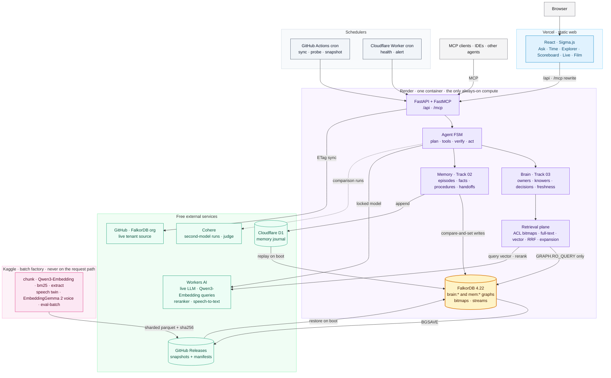
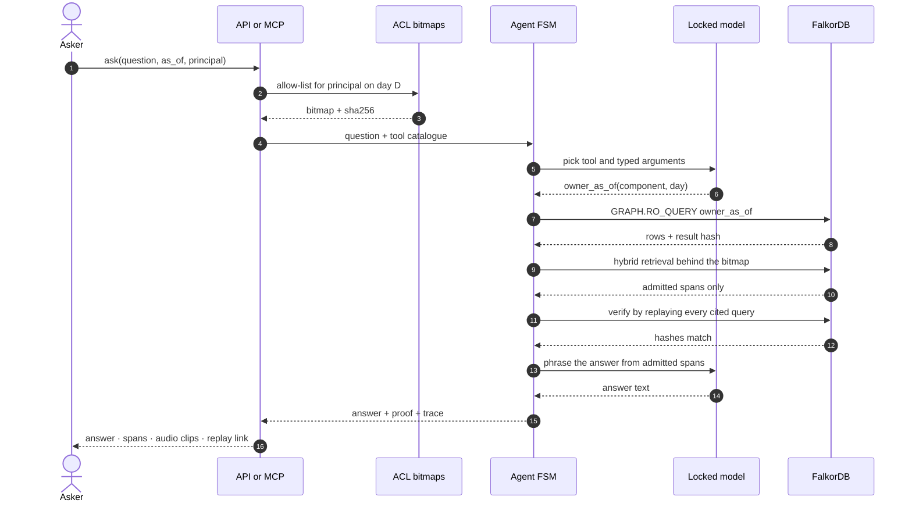
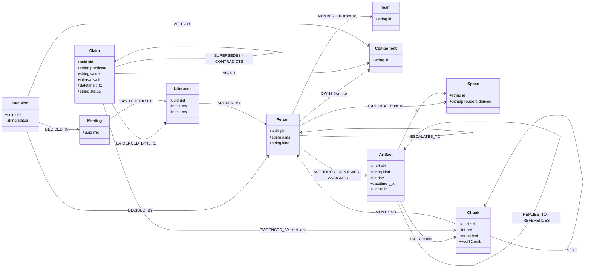
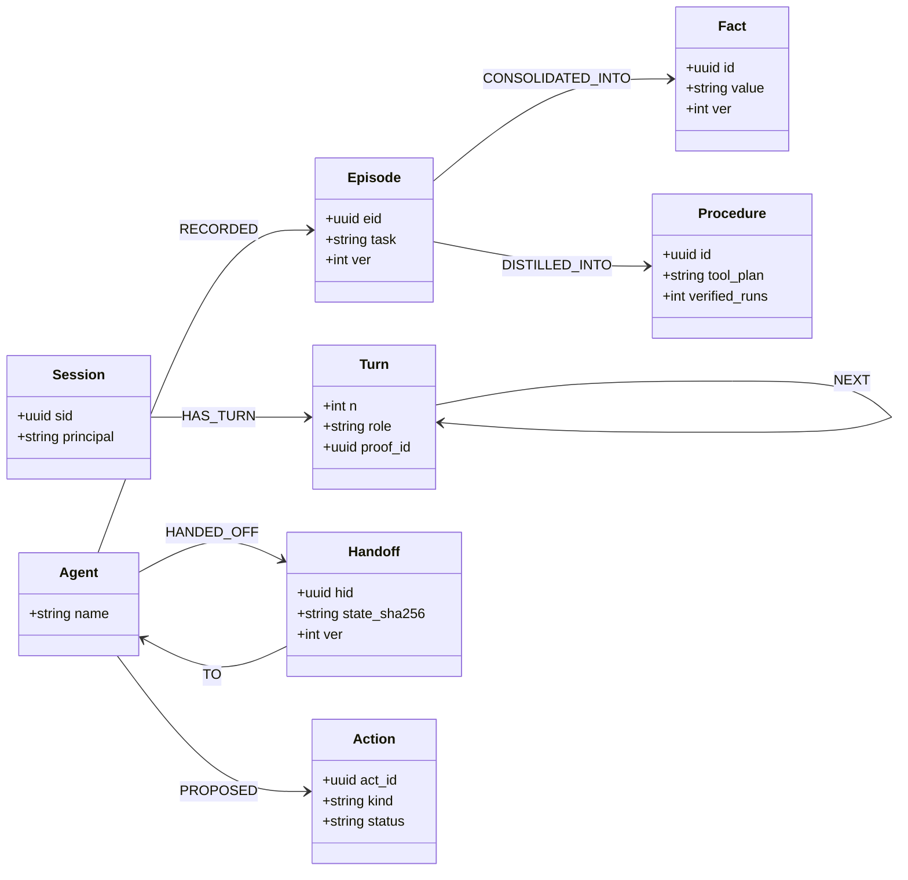
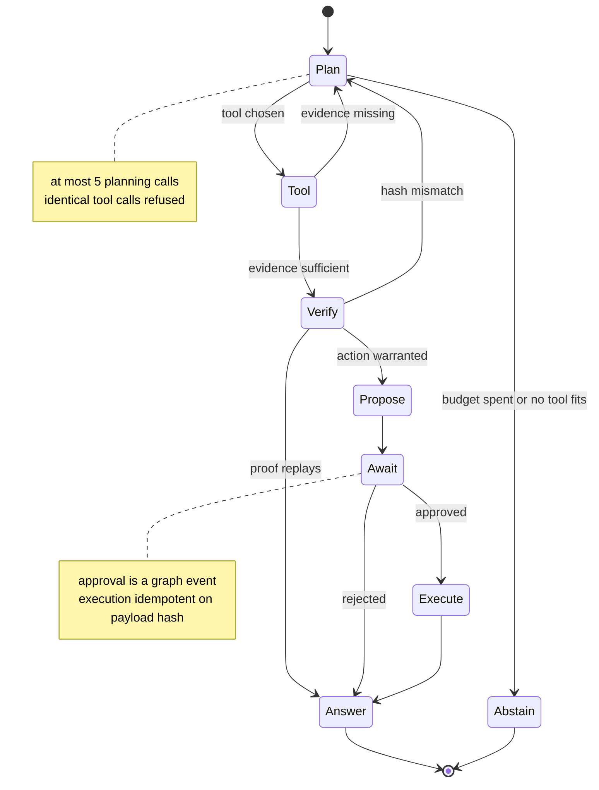
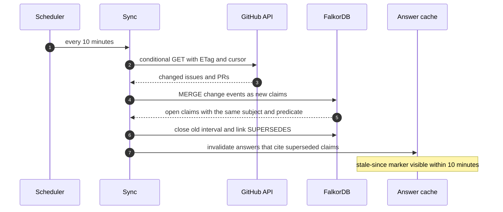

# Constellation

**The company brain that proves every answer — what's true, who knew it, and when. Exact to the bit, replayable to the source, on FalkorDB.**

Built for **Graph Hacks: Context for AI Agents** (WeMakeDevs × FalkorDB). Entered in **Track 01 · Agents That Act**, **Track 02 · Agent Memory and Coordination** and **Track 03 · Company Brain**.

> **Status:** specification frozen, build in progress. Every number on this page will come from a recorded run; until then there are none. Live progress: [`STATE.md`](STATE.md) · full design: [`PLAN_SPEC.md`](PLAN_SPEC.md).

---

## Why it is different

Most company-knowledge agents retrieve text and hope. Constellation treats company memory as **visibility × time** and stores both in FalkorDB:

- **Valid time.** When a fact held, as half-open intervals on edges.
- **Transaction time.** When the company recorded it.
- **Visibility.** Who could see it, compiled into exact permission bitmaps.

So every answer is a **proof**: the read-only Cypher that ran, its parameters, the result hash, the cited spans down to the character or the audio millisecond, and the permission check that admitted each one.

| Wall | In one line |
|---|---|
| **Truth** | Scored by answer keys we did not write: EpistemicBench and EnterpriseRAG-Bench |
| **Bits** | Permissions as exact bitmaps; zero leaks is an invariant, proven by property tests |
| **Proof** | Any answer replays to the same bytes |
| **Voice** | Meetings exist as speech, so a decision links to the second it was spoken |
| **FalkorDB-native** | Algorithms as agent tools, `GRAPH.COPY` tenancy, `GRAPH.RO_QUERY` read path, MCP; the live tenant is FalkorDB's own organisation |

## Tracks

| Track | What Constellation does |
|---|---|
| **03 · Company Brain** | Docs, tickets, chats, code and meetings in one bitemporal graph. Who owned what on any day; who *engaged with* versus who was merely *exposed to* a fact; decisions traced to the exact span; claims superseded as the live tenant changes |
| **01 · Agents That Act** | A bounded agent whose tools are reviewed Cypher and FalkorDB algorithms served over MCP. It routes, escalates and files issues only after approval, and every step lands in a trace |
| **02 · Memory and Coordination** | Per-tenant and per-user memory graphs cloned with `GRAPH.COPY`: episodic, semantic and procedural layers, persistent sessions, handoffs, and compare-and-set writes with zero lost updates |

## Architecture



## How an answer is proven



## Graph data model

Brain graph, one per tenant (`brain:<tenant>`):



Memory graph, one per user and session (`mem:<tenant>:<principal>`):



## The agent



The model chooses *what to ask*; it almost never writes query text. Reviewed catalogue queries come first, chained for multi-hop questions. Generated Cypher is a guarded last resort: it is parsed with `GRAPH.EXPLAIN`, checked against an allowlist, capped, run with `GRAPH.RO_QUERY`, and re-checked against the permission bitmap ([PLAN_SPEC §11](PLAN_SPEC.md)).

## Cypher the product relies on

```cypher
// owner_as_of — who owned a component on day D (half-open interval)
MATCH (p:Person)-[o:OWNS]->(c:Component {id: $component})
WHERE o.from <= $day AND (o.to IS NULL OR $day < o.to)
RETURN p.alias AS owner, o.from AS since, o.aid AS evidence
```

```cypher
// escalation_path — shortest escalation chain valid on day D
MATCH (a:Person {pid: $from}), (b:Person {pid: $to})
MATCH p = shortestPath((a)-[:ESCALATES_TO*..6]->(b))
WHERE all(r IN relationships(p) WHERE r.from <= $day AND (r.to IS NULL OR $day < r.to))
RETURN [n IN nodes(p) | n.alias] AS chain
```

The full catalogue, including the knowledge frontier, decision provenance, stale-claim detection and the algorithms used as tools, is in [PLAN_SPEC §7](PLAN_SPEC.md).

## Keeping knowledge current



## Data

| Tenant | Source | Licence |
|---|---|---|
| Apex Athletics | OrgForge simulated company, with the EpistemicBench questions | MIT |
| Redwood Inference | EnterpriseRAG-Bench: 511,962 documents and 500 questions | MIT |
| FalkorDB OSS (live) | Public metadata of the FalkorDB GitHub organisation, people pseudonymised | Public |

Only public and synthetic data is used. People appear as stable pseudonyms. Benchmark corpora are never re-published in bulk.

## Results

None yet. Each figure will link to the run that produced it, with official raw scores published alongside gold-audited scores.

## Running it

Setup instructions land with the first runnable build. The target is a single `docker compose up` that starts FalkorDB, the API and the web app.

## AI assistance

AI coding assistants were used during development, as the hackathon rules allow. Every change is reviewed, tested and understood by the author, who can explain the code, the graph model, the queries and the architecture decisions.

## Prior art

The author previously built *Stellium* (agentic GraphRAG on TigerGraph) and *Lunarbit* (evidence-verifiable GraphRAG on Neo4j). Constellation carries over their engineering discipline, not their code. All FalkorDB work here was built during the event.

## Licence

[MIT](LICENSE)
